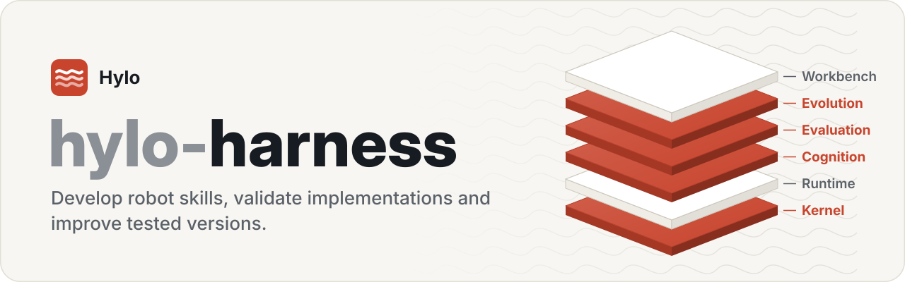
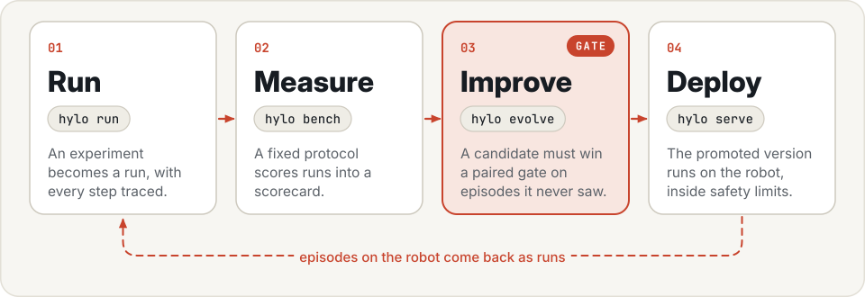
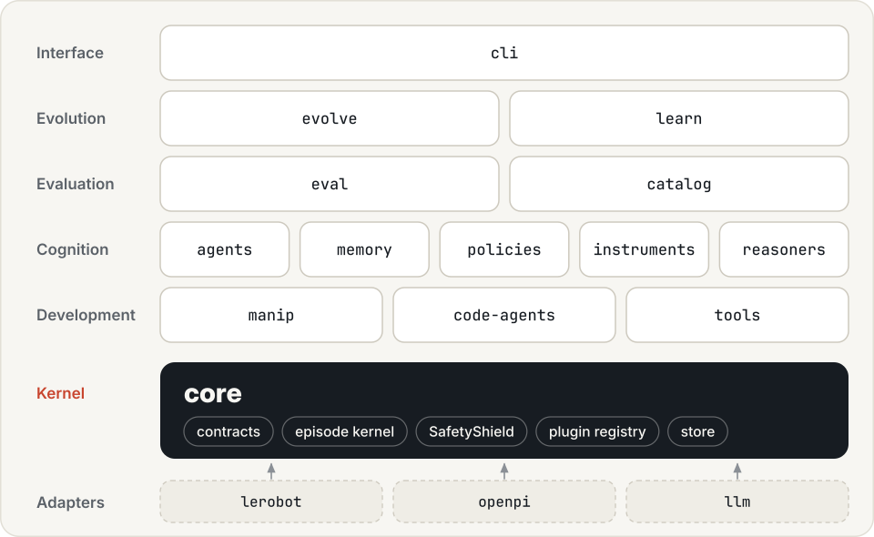
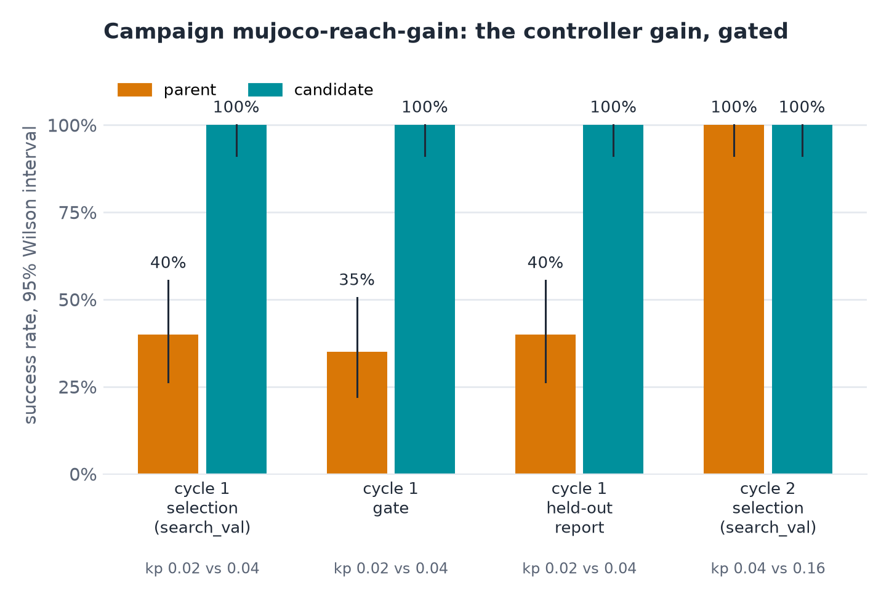
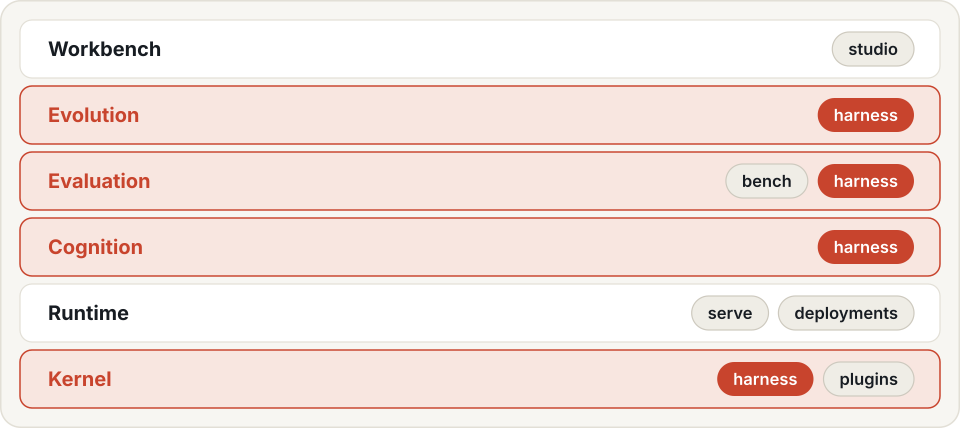

<p align="center">
  <picture>
    <source media="(prefers-color-scheme: dark)" srcset=".github/assets/banner-dark.svg">
    
  </picture>
</p>

<p align="center">
  <a href="LICENSE"></a>
  
  <a href="https://docs.astral.sh/uv/"></a>
  
</p>

<p align="center">
  <a href="https://hyloai.github.io/"><b>Website</b></a> ·
  <a href="https://hyloai.github.io/hylo-docs/"><b>Docs</b></a> ·
  <a href="https://hyloai.github.io/hylo-docs/getting-started/quickstart/"><b>Quickstart</b></a> ·
  <a href="https://github.com/HyloAI"><b>All repositories</b></a>
</p>

Part of [Hylo](https://hyloai.github.io/), the stack for physical AI. This repository holds the **kernel** and the
shared layers built on it: **cognition**, the **evaluation** engine and **evolution**.

The base of Hylo: contracts and execution kernel, evaluation engine, agents, memory, learning, gated
improvement campaigns, the run catalog and the adapters to policy stacks and LLMs. Every other Hylo
repository (bench, serve, studio, plugins) builds on this one and talks to the others only through formats defined
in `hylo-core`.

The user-facing workflow is the lifecycle of robot skills: develop, run, validate, improve and reuse task
capabilities with recorded evidence. Robot tools and code agents help construct program implementations;
existing model policies and controllers use the same kernel, traces and evaluation machinery. Skill-library
records cover specific reuse paths, including promoted programs.

[Robot skills and their lifecycle](https://hyloai.github.io/hylo-docs/user-guide/skills/)

<p align="center">
  <picture>
    <source media="(prefers-color-scheme: dark)" srcset=".github/assets/loop-dark.svg">
    
  </picture>
</p>

## Packages

<p align="center">
  <picture>
    <source media="(prefers-color-scheme: dark)" srcset=".github/assets/architecture-dark.svg">
    
  </picture>
</p>

| Package | Namespace | Purpose |
|---|---|---|
| `packages/hylo-core` | `hylo.core`, `hylo.testing` | contracts, kernel, SafetyShield, events and traces, plugin registry, experiment config, remote protocols and wire codec, artifacts and the split guard, cross-repository formats (active version, scorecard, workcell API), conformance kit, the `hylo` dispatcher |
| `packages/hylo-eval` | `hylo.eval` | benchmark contract and splits, evaluation runner, scorers, paired statistics and gate tests, the test benchmark (testing/reach-v0) |
| `packages/hylo-agents` | `hylo.agents` | decision-making: agents that run any policy (chunked, ACT temporal ensemble, steered), memory / critic / noise steering, skills, planner, shadow agent; installs with hylo-core alone (extras `critic`, `rules`) |
| `packages/hylo-instruments` | `hylo.instruments` | models that measure or predict, never act: success judges, chunk value models, world models and the world-model environment |
| `packages/hylo-reasoners` | `hylo.reasoners.rules` | rule-based reasoners and choosers (the LLM / VLM ones are in `adapters/hylo-reasoner-llm`) |
| `packages/hylo-memory` | `hylo.memory` | action and noise banks, skill library, lesson book, SQLite memory |
| `packages/hylo-policies` | `hylo.policies.reference` | reference policies, one per family (kNN, BC, flow matching, tokens, MPC), numpy only, trained from your runs |
| `packages/hylo-learn` | `hylo.learn` | learner jobs and sealed artifacts, judge calibration and labelling, external-data ingestion, online learning |
| `packages/hylo-evolve` | `hylo.evolve` | improvement protocol: diagnosis, candidates, cascade and group-sequential gate, registry with rollback, campaigns |
| `packages/hylo-catalog` | `hylo.catalog` | read-only queries over runs, episodes, comparisons, campaigns and artifacts |
| `packages/hylo-cli` | `hylo.cli` | `hylo run`, `hylo evolve`, `hylo learn`, `hylo calibrate`, `hylo plugin`, ... |
| `packages/hylo-manip` | `hylo.manip` | robot tools: perception, kinematics, grasps and motion planning over `RobotSpec`; MuJoCo is the current kinematics backend |
| `adapters/hylo-code-agents` | `hylo.codeagents` | `code.llm`, `code.program`, research sessions, code candidates and program skills; `tools.llm` (typed tool calls), `hylo watch`, `hylo preflight`, `hylo mcp`, `hylo chats`, `hylo world` sessions and `hylo roles` campaigns; experimental scene, replay and motion workflows |
| `adapters/hylo-tools` | `hylo.tools` | perception, motion and rendering models in independent worker environments; `physicalize` (collision geometry for meshes) |
| `adapters/hylo-policy-lerobot` | `hylo.policies.lerobot` | LeRobot policies (SmolVLA, ...) with steering, their learners and builders |
| `adapters/hylo-policy-openpi` | `hylo.policies.openpi` | client for openpi policy servers (pi0, pi0-FAST, pi0.5) |
| `adapters/hylo-reasoner-llm` | `hylo.reasoners.llm` | chat models with native tool calls (OpenAI-compatible, Anthropic, coding-agent CLIs) and runtime LLM / VLM components (planner, VLM judge) |
| `adapters/hylo-proposer-llm` | `hylo.proposers.llm` | LLM candidate proposer and reflector for campaigns |
| `adapters/hylo-data-video` | `hylo.datasources.video` | videos as external data sources |

Environment implementations live in hylo-bench. The harness's `examples/` exercises core, agents, memory, learning
and evolution against installed environments. Code-agent programs and measured workflows live under
`adapters/hylo-code-agents/examples/`; bench also has environment configs and benchmarking examples. Unit tests
use a test double (`hylo.testing`, plugins named `testing.*`, hidden from `hylo plugins` unless `--all`).

```bash
uv run hylo plugins                                          # plugins: contract version, maturity, licence
uv run hylo store ls                                         # runs and artifacts in this machine's store, by id
uv run hylo plugin new policy my-policy                      # scaffold a plugin package (policy, agent, guard, ...)
uv run pytest                                              # unit tests on the test double
```

Documentation: [extending Hylo](docs/extending.md), [package layering](docs/dependency-graph.md),
[interfaces](docs/interfaces/), [plugin system](docs/plugin-system.md), [experiment schema](docs/experiment-schema.md).
Architecture, RFCs and research live in hylo-docs.

## Develop and reuse robot skills

Use `code.program` for a Python `solve(robot)` strategy, `code.llm` for a model writing code during an episode,
or `hylo research` to develop and freeze programs on development cases. Programs use the manipulation tools;
actions still pass through the kernel and SafetyShield. First-task validation checks task requirements; an
improvement claim additionally needs an independent comparison with a baseline.

Start with [Developing robot skills](https://hyloai.github.io/hylo-docs/user-guide/developing-strategies/), then
[Skill research, validation and reuse](https://hyloai.github.io/hylo-docs/user-guide/research-and-skills/).
[Recorded results](adapters/hylo-code-agents/examples/README.md) include reference programs, a model-improved stacking
program and skill reuse, with observation privileges and limitations stated. Free-scene and motion-free showcase
requests remain unrun. The Python namespace restriction is not operating-system isolation.

## Tool-calling agents and worlds

`tools.llm` lets a chat model operate the robot through typed tools, one checked action at a time: each action runs
through the kernel and the SafetyShield and comes back as a measured receipt. `hylo watch` follows or steers a run,
`hylo preflight` checks a model and a config first, and `hylo seal` verifies the hash-chained trace and locks the run.
Stages (`hylo.core.stage`) describe scenes with revisions; bench builds them into MuJoCo worlds with 24 robot packs,
and `hylo world chat`, `hylo mcp` and the Studio run them through the same tools. See
[Tool-calling agents](https://hyloai.github.io/hylo-docs/user-guide/tool-agents/) and
[Worlds](https://hyloai.github.io/hylo-docs/user-guide/worlds/).

## Gated improvement

A campaign changes the agent only through a gate: a candidate has to beat its parent in a paired test on episodes
the proposer never saw, and is reported on held-out episodes before anyone approves it. Below, a recorded campaign on
MuJoCo reach: the candidate controller gain went from 40% to 100% success on selection, gate and held-out splits; in
cycle 2 the parent was already at 100% and nothing was promoted.

<p align="center">
  
</p>

## The Hylo repositories

<p align="center">
  <picture>
    <source media="(prefers-color-scheme: dark)" srcset=".github/assets/stack-dark.svg">
    
  </picture>
</p>

| Repository | What it holds | Depends on |
|---|---|---|
| hylo-harness (this one) | the base: contracts and kernel, evaluation engine, agents, memory, learning, improvement campaigns, run catalog and store, adapters, `hylo` | - |
| [hylo-bench](https://github.com/HyloAI/hylo-bench) | benchmarking: protocols, scorecards, leaderboards; LIBERO and MuJoCo suites and their setup | harness |
| [hylo-serve](https://github.com/HyloAI/hylo-serve) | deployment: policy server, workcell, real-time runner, operator channel, robot adapters | harness (hylo-core only) |
| [hylo-studio](https://github.com/HyloAI/hylo-studio) | the playground: control plane, run explorer, live sandbox, campaigns, React front end | harness |
| [hylo-plugins](https://github.com/HyloAI/hylo-plugins) | example and community plugins | harness |
| [hylo-docs](https://github.com/HyloAI/hylo-docs) | architecture, RFCs, research notes, experiment records | - |
| [deployments-template](https://github.com/HyloAI/hylo-deployments-template) | template for a lab's private `<lab>-deployments`: workcell configs, calibration, safety limits | - |

Leaves never import each other; they cooperate through formats defined in `hylo-core`.

## Development workspace

The repositories sit side by side in one directory (named `harness/`, `bench/`, `serve/`, `studio/`, `plugins/`,
`docs/`, `deployments-template/`); `dev/bootstrap.sh` clones the missing ones (`HYLO_GIT_BASE`), writes a uv
workspace over all of them (`dev/workspace.py`) and installs every package editable into one venv:

```bash
mkdir hylo && cd hylo                    # Python 3.10+, uv
git clone https://github.com/HyloAI/hylo-harness.git harness
HYLO_GIT_BASE=https://github.com/HyloAI harness/dev/bootstrap.sh   # clones the other repositories, one venv
uv run pytest                            # every present repository, plus the boundary lint (harness/dev)
uv run hylo --help                         # subcommands contributed by the installed packages
uv run hylo run bench/examples/configs/mujoco_table_memory.yaml    # language + spatial memory, MuJoCo table
uv run hylo evolve run bench/examples/evolve/mujoco_reach_gain.yaml # a gated improvement campaign
```

A subset works too (the harness alone, or the harness and one leaf): the workspace covers whatever is present.
`dev/repos.toml` lists the repositories and their allowed dependencies; `dev/test_boundaries.py` checks package
layering and repository rules. Rules: core functionality before infrastructure; third-party code stays out of the
packages (see hylo-docs); every package keeps its own tests and dependencies.

Documentation (hylo-docs, `uv run mkdocs serve -f docs/mkdocs.yml` from the workspace): [home](../docs/docs/index.md), [installation](../docs/docs/getting-started/installation.md), [concepts](../docs/docs/getting-started/concepts.md), [design overview](../docs/docs/design/overview.md).

## License

Apache License 2.0 (see [LICENSE](LICENSE)). Copyright 2026 Hylo AI.
