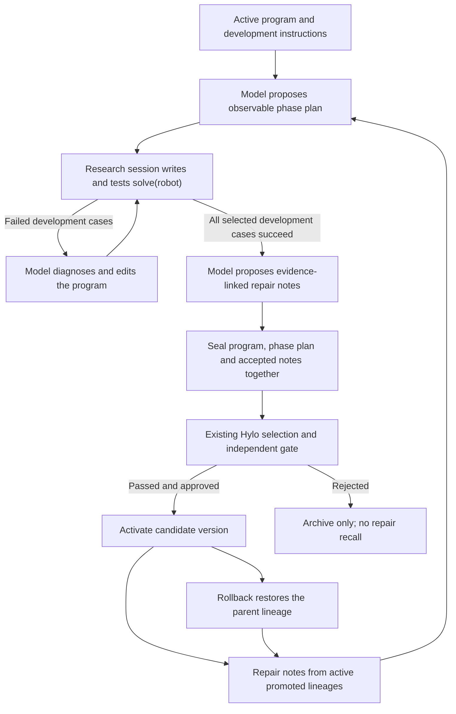

# Harness Program Evolution

For the shared campaign lifecycle, strategy options and version management, see the
[Self-Evolution README](../../../../packages/hylo-evolve/README.md).

`harness.program` is an optional Hylo evolution strategy inspired by HarnessPAI's
program-repair and phase-scoped skill-memory design. It independently implements phase
planning, iterative program development and evidence-linked repair recall. It performs no
weight training and coexists with `research.llm`, steering proposers and memory strategies.

The pinned HarnessPAI source has no project license. This implementation uses Hylo's own
research sessions, kernel, artifact format and promotion protocol; no HarnessPAI source,
prompts or templates are copied. It is a design adaptation, not a reproduction of the
authors' benchmark result or a drop-in implementation of their runtime.

## Workflow



1. Read instructions from the benchmark's `search` cases. A supplied diagnosis must also
   have a `search` manifest; selection, gate and held-out data are not sent to the model.
2. Retrieve relevant admitted repair notes and ask the model for named phases, observable
   completion conditions, fallback behavior and step budgets.
3. Run a bounded Hylo `ResearchSession`: inspect the parent program, submit alternatives,
   inspect development outcomes and repair failures. All selected development cases must
   succeed before this strategy returns a candidate. This strategy enables `auto_submit`:
   after a completed block changes the collected program, evaluate it and send the results
   back to the model. Explicit submissions are not duplicated; unchanged programs and
   revisions beyond the submission budget are not automatically evaluated. Other research
   proposers retain their existing explicit-submission behavior.
4. Distill repair notes only when failed submissions exist. Each note must reference a real
   failed case and a successful replay of that case in the selected program. Invalid notes
   are discarded; the otherwise valid program can still proceed without notes.
5. Seal the program, plan, notes and evidence into a new artifact. The existing campaign
   performs selection, independent paired validation, reporting and configured approval.
6. Recall notes only from promoted candidates on each configured campaign's current active
   lineage. A gate-passing candidate awaiting manual approval remains invisible. Rollback
   automatically removes the retired branch's notes from subsequent queries.

## Components

| Source | Responsibility |
| --- | --- |
| [harness_evolution.py](../../src/hylo/codeagents/harness_evolution.py) | Strategy orchestration, phase planning, development and repair distillation |
| [phase_memory.py](../../src/hylo/codeagents/phase_memory.py) | Typed phase plans and repair notes, evidence checks, active-lineage retrieval |
| [research.py](../../src/hylo/codeagents/research.py) | Existing interactive development, program submissions and observation/tool execution |
| [skills.py](../../src/hylo/codeagents/skills.py) | Existing sealed programs and program-skill integration |
| [test_harness_evolution.py](../../tests/test_harness_evolution.py) | Failed-program repair, gate, approval, recall, corruption and rollback tests |

A phase contains `name`, `goal`, `completion`, `fallback` and `step_budget`. The phase plan
is guidance for code generation. Generated code must implement the phase checks and bounded
loops; this release does not introduce a centrally enforced phase-state-machine interpreter.
The existing kernel and research runtime enforce their overall episode, execution-time and
session budgets. Evaluator outcomes, rather than program exit or printed claims, determine
development and gate success.

A repair note contains `phase`, `trigger`, `repair`, `limitation`, `failure_refs` and
`success_refs`. It is advice tied to a program that passed a gate; it is not an independently
verified transferable skill. Recall reports `program_gate_passed: true` and
`transfer_verified: false`. Retrieval uses lexical overlap and an optional exact phase-name
boost, not embeddings. The files and provenance are checked against the sealed digest,
which must also match the artifact digest recorded in the admitted candidate.

## Selection

Use the registered generator after installing the updated adapter:

```yaml
proposer:
  type: harness.program
  params:
    model: {backend: ollama, model: gpt-oss:20b, reasoning_effort: low}
    dev: 6
    budget: {turns: 40, submits: 6, resets: 12}
    out_root: runs/harness-program/proposals
    repair_campaigns: [runs/harness-program]
```

`repair_campaigns` names campaign directories, not arbitrary note folders. Sharing several
campaign directories enables cross-task retrieval while retaining the active-lineage rule
for each source. It does not establish that a retrieved repair transfers to another task.

The [example campaign](campaign.yaml) uses a module reference, which also works before
reinstalling entry-point metadata. It targets the [CPU toy environment](experiment.yaml),
with an intentionally inactive baseline and an existing local Ollama model. From the
workspace root, with Hylo and that model service already available:

```bash
.venv/bin/python -m hylo.core.cli evolve run \
  harness/adapters/hylo-code-agents/examples/harness_evolution/campaign.yaml
```

To retain the resolved protocol, relevant source snapshots and campaign outcome in a new
directory, use the [probe runner](run_probe.py):

```bash
.venv/bin/python harness/adapters/hylo-code-agents/examples/harness_evolution/run_probe.py \
  --out runs/harness-program-probe --model gpt-oss:20b
```

The probe uses 16 total model calls, four submissions, four resets, a 180,000-token budget
and a 90-second per-request timeout. It refuses to reuse an existing output directory.

The strategy makes one planning call, a bounded research session and at most one
distillation call. `budget.turns` includes all three stages; two calls are reserved for
planning/distillation. Token and reported-cost budgets are shared across stages and checked
between calls. Unknown model prices remain unknown in accounting. No model or simulator
dependencies are installed by the strategy.

## Runtime Boundary

Programs use the configured Hylo robot toolkit and its kernel action path. The strategy
asks for observation-based completion checks and does not supply evaluator traces from
gate or held-out splits to the coding model. Observation permissions still depend on the
chosen environment/toolkit; a phase plan is not an isolation mechanism.

HarnessPAI's model/code handover is represented here as a code-generation design: a program
may call a frozen action-model tool when the configured toolkit provides one. This release
does not add a general VLA driver or automatically turn a SimpleMemVLA agent into such a
tool. The bundled CPU example uses manipulation tools, not a VLA. Video diagnosis,
per-phase capability estimation and expert-data collection for VLA training are outside
this implementation.

## Verification

The CPU integration test uses a scripted reasoning model and the actual Hylo kernel and
campaign gate: a no-movement program fails, a repaired program succeeds, the candidate
waits for approval, its repair becomes retrievable on promotion and disappears on rollback.
Other tests reject fabricated repair evidence, mismatched cases, corrupted artifacts and
gate-split diagnostic inputs. A program that does not solve all selected development cases
does not become a candidate. These tests establish mechanics, not autonomous model ability.
Automatic submission tests cover omitted `submit()` calls, duplicate program definitions
and exhausted submission budgets. An integrity test also rejects a changed artifact that
was resealed at the same path after its candidate was admitted.

```bash
.venv/bin/python -m pytest \
  harness/adapters/hylo-code-agents/tests/test_harness_evolution.py \
  harness/adapters/hylo-code-agents/tests/test_research.py \
  harness/adapters/hylo-code-agents/tests/test_real_toolkit.py \
  harness/adapters/hylo-code-agents/tests/test_prompt_context.py \
  harness/packages/hylo-evolve/tests/test_campaign.py \
  harness/packages/hylo-evolve/tests/test_protocol.py -q
```

Local CPU checks on 2026-11-04 passed: 33 strategy and regression tests, followed by all
11 strategy tests after adding the artifact-replacement case (34 distinct tests in total).
The scripted integration test's perfect toy scores are not an autonomous learning result.
Real-model probe outcomes and remaining limitations are recorded in
`docs/docs/research/experiments/2026-11-04-harness-program-evolution.md` in the workspace.

## Design Sources

The existing source study pins `Darwin-Agent/HarnessPAI` at
`3af7d561d531ce3e3a3884a3f801c41b8b98e2fe`. The following are design references, read statically:

- Generated phase programs and model/code handover:
  `references/memory/HarnessPAI/harnesspai/code_library/TEMPLATE.md:20` and `:187`.
- Development rollout followed by code promotion and repair-summary writeback:
  `references/memory/HarnessPAI/harnesspai/evolution/loop.py:793` and `:839`.
- Phase-scoped repair retrieval:
  `references/memory/HarnessPAI/harnesspai/memory/skill/query.py:44` and `:112`.
- Post-write structural checks:
  `references/memory/HarnessPAI/harnesspai/memory/skill/writeback.py:389`.

Paths above are relative to the docs research workspace. Its HarnessPAI worktree is
unpopulated; the study and this implementation's design check used read-only `git show`
at the recorded commit. Hylo adds its existing independent gate and digest-bound notes,
with recall tied to active versions, rather than treating development success as promotion.
