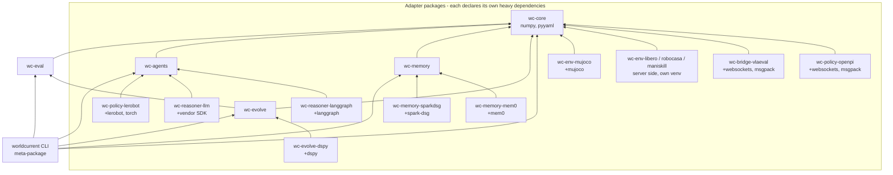
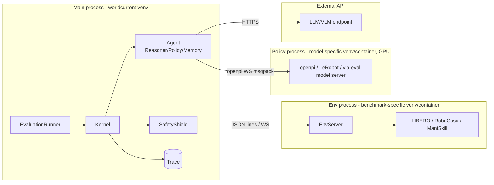
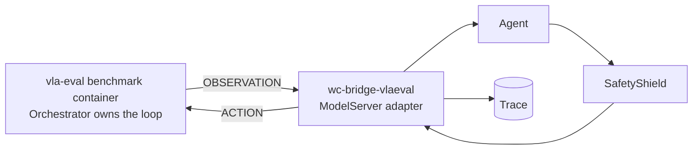

# Module Dependency Graph

> Current package table and enforced rules: docs/design/architecture.md §2.1 and `dev/test_boundaries.py`
> (which also checks the repository rules of docs/design/repository-structure.md). The graph below is the
> original design (2026-10-30); package names follow the current ones.

## 1. Package dependencies (compile-time import relationships)

**Dependency rules** (enforced in CI with an AST import-lint, modeled on Zetta's `test_layering.py`):

1. `wc-core` does not import any other worldcurrent package.
2. `wc-eval`, `wc-agents` and `wc-memory` depend only on `wc-core` and **do not depend on each other**.
   - Memory does not know about Agent; Agent holds a memory instance through the `MemoryStore` protocol (dependency injection).
   - Bench does not know Agent internals; Scorers only read the Trace.
3. `wc-evolve` depends on `wc-core` + `wc-eval` (it needs to run evaluations); it interacts with memory/agents only through config patches and protocols.
4. No non-adapter package **may** import an adapter package; adapter packages do not depend on each other.
5. Heavy dependencies (torch, jax, mujoco, langchain-core, dspy, robosuite) appear only in adapter packages.

> Resolved in the workspace packages: memory contracts (`MemoryItem`, `MemoryQuery`, `MemoryStore`, `WorkingMemory`) live in `worldcurrent.core.memory`; agents obtain a backend through the `memory` plugin group, so wc-agents and wc-memory never import each other. `dev/test_boundaries.py` enforces rules 1–5 on every `src/` tree.

## 2. Runtime process topology

In **Served mode** the topology is inverted: the vla-eval benchmark container owns the loop, and our process acts as the model server:

## 3. Summary of how external projects are depended on

| External project | Method | Target package |
|---|---|---|
| MuJoCo | PyPI dependency | wc-env-mujoco |
| LIBERO / RoboCasa / ManiSkill | PyPI/source dependency in a separate venv | wc-env-* (server side) |
| vla-evaluation-harness | Protocol-compatible + run its containers | wc-bridge-vlaeval |
| openpi | Protocol-compatible (no import) | wc-policy-openpi |
| LeRobot | Optional dependency + data format export | wc-policy-lerobot, wc-eval (exporter) |
| inspect-robots | Port code (MIT, with attribution) | wc-core (safety/compat parts) |
| RPent | Port the tool layer (Apache-2.0, with attribution) | wc-agents (tools) |
| Zetta | Borrow schema design, rewrite | wc-evolve |
| LangGraph / DSPy | Optional dependency | wc-reasoner-langgraph / wc-evolve-dspy |
| Spark-DSG / mem0 / Graphiti | Optional dependency | wc-memory-* |
