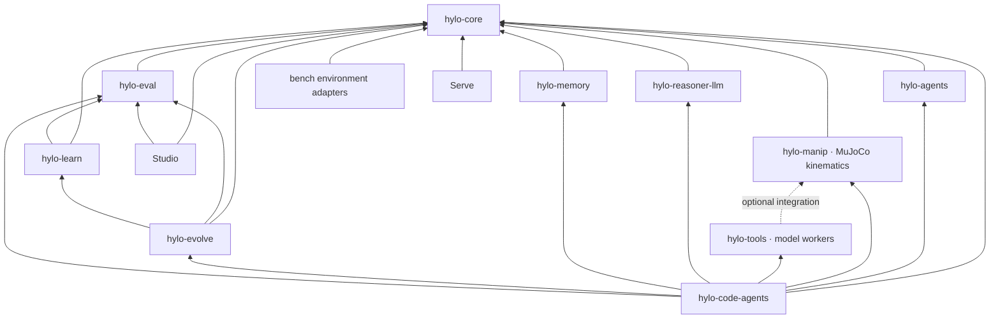
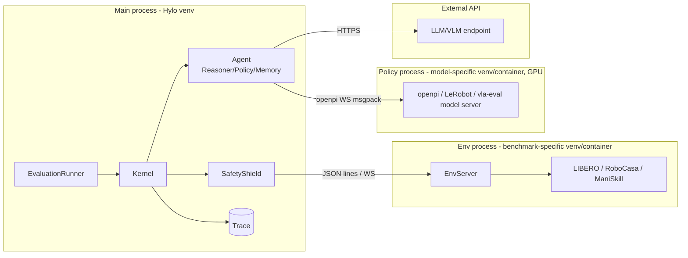
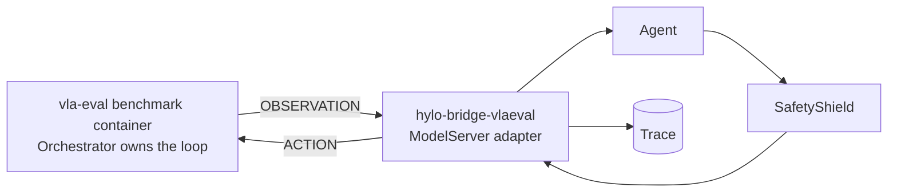

# Module Dependency Graph

The runtime core remains independent of simulators and models. Strategy development adds robot tools and program
agents above that core; environments remain in bench and heavy model tools run in their own worker environments.
`dev/test_boundaries.py` enforces installed package dependencies and cross-repository imports.

## 1. Package dependencies

Selected relationships are shown; `dev/test_boundaries.py` contains the complete allowed dependency table.
`hylo-tools` declares manipulation integration as an optional dependency. `hylo-manip` deliberately uses MuJoCo
for its current kinematics/collision backend even when the environment is remote; the core contracts do not.

**Dependency rules**

1. `hylo-core` imports no other Hylo package. Robot and scene descriptions are simulator-independent data.
2. The harness imports no leaf repository. Bench, serve, studio and plugins never import one another.
3. Decision-making, memory, measurement and development remain separate packages; optional components load only
   when requested. The robot-side serve packages declare only core by default.
4. MuJoCo imports are allowed in `hylo-manip`, the MuJoCo environment adapter, `hylo-tools` and code-agent workflows
   as listed by the boundary lint. Torch and conflicting model dependencies stay in policy/tool worker environments.
5. Cross-repository runtime contracts live in core. Studio reads producer-owned research JSON/JSONL records without
   importing their producer; changes to these records must preserve tolerant readers.

## 2. Runtime process topology

In **Served mode** the topology is inverted: the vla-eval benchmark container owns the loop, and our process acts as the model server:

## 3. Summary of how external projects are depended on

| External project | Method | Target package |
|---|---|---|
| MuJoCo | PyPI dependency | hylo-env-mujoco |
| LIBERO / RoboCasa / ManiSkill | PyPI/source dependency in a separate venv | hylo-env-* (server side) |
| vla-evaluation-harness | Protocol-compatible + run its containers | hylo-bridge-vlaeval |
| openpi | Protocol-compatible (no import) | hylo-policy-openpi |
| LeRobot | Optional dependency + data format export | hylo-policy-lerobot, hylo-eval (exporter) |
| inspect-robots | Port code (MIT, with attribution) | hylo-core (safety/compat parts) |
| RPent | Port the tool layer (Apache-2.0, with attribution) | hylo-agents (tools) |
| Zetta | Borrow schema design, rewrite | hylo-evolve |
| LangGraph / DSPy | Optional dependency | hylo-reasoner-langgraph / hylo-evolve-dspy |
| Spark-DSG / mem0 / Graphiti | Optional dependency | hylo-memory-* |
