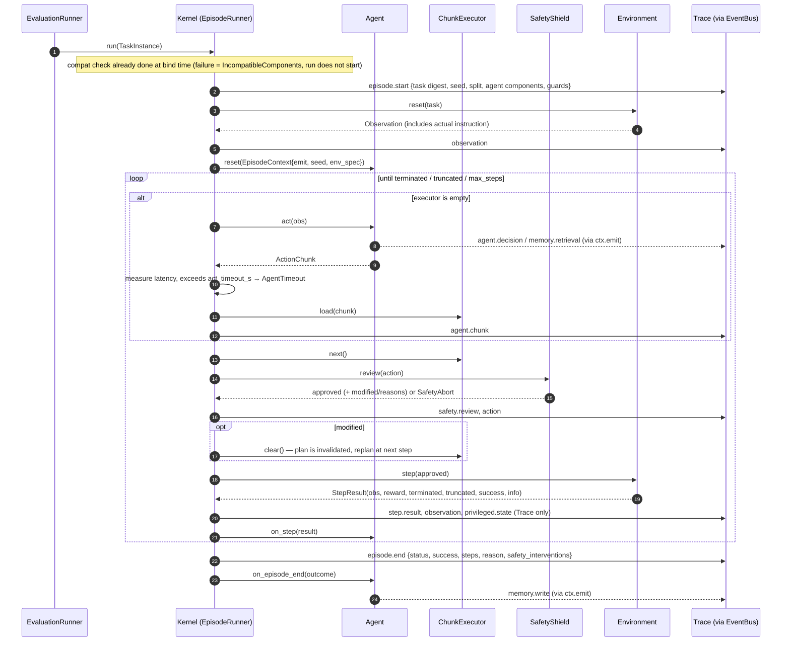
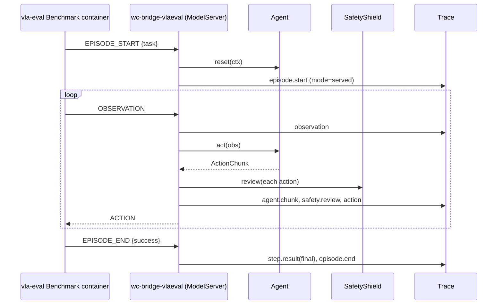

# Execution Lifecycle

> Implementation: wc-core `worldcurrent/core/kernel.py` **[Validated in prototype]**

## 1. Hierarchy

```text
Experiment ──▶ Evaluation Run (benchmark × split) ──▶ Episode (TaskInstance) ──▶ Step
   │                    │                                  │                       │
 config digest      run_id, manifest                 episode_id, seed          seq, sim_time
```

## 2. Driven mode (default): the Kernel owns the loop



### 2.1 Status and errors

| Situation | episode status | Scored? | Prototype behavior |
|---|---|---|---|
| Task judged successful | `success` | 1 | ✓ |
| Steps exhausted or truncated | `failure` | 0 | ✓ |
| Agent raises an exception / times out | `error` | **Abstain** | ✓ |
| Env reset/step exception | `infra_invalid` | **Abstain** | ✓ |
| Simulation divergence (MuJoCo BADQPOS/QVEL/QACC) | `infra_invalid` | **Abstain** | ✓ |
| Guard rejection (NaN, rotation out of bounds, any modification in real-robot mode) | `safety_abort` | 0 + safety event | ✓ |
| Incompatible at bind time | run does not start | — | ✓ |

### 2.2 Chunk execution

`ActionChunk(actions[T], execution_steps)`: after executing `execution_steps` steps, `act` is called again. If SafetyShield modifies any action → the queue is cleared to force a replan (the plan has diverged from reality).

`Timing` (RFC-0005, part of what an experiment measures) selects how policy time relates to robot time, in the one
loop that evaluation and deployment share:
- `sync` (default): the above; the world waits for every `act`.
- `realtime`: a chunk is requested when at most `refill_steps` actions remain (earlier when recent latency needs
  it); a chunk computed at step s and merged at step t has its first t - s actions dropped; an empty queue
  executes a hold action; a watchdog aborts after `max_hold_steps` holds. Clock `virtual` (deterministic: latency
  measured or fixed by `latency_s`, the steps it covers run before the merge) or `wall` (the policy in a worker
  thread, the loop paced at the control rate). The workcell (wc-serve) runs this mode; a benchmark protocol can
  score it (`libero-10-heldout-realtime`).
Temporal ensembling is an agent (`temporal_ensemble`), not a loop variant.

### 2.3 Clock and timeouts

- `act` latency is measured after the fact; exceeding `act_timeout_s` yields `AgentTimeout` (soft timeout).
- v0.2: hard timeouts for remote policies are guaranteed by client deadlines; hard timeouts for in-process policies require thread/subprocess isolation.
- Real robot: when `EnvCapabilities.self_paced=True`, the Environment is responsible for wall-clock pacing and the Kernel does not sleep; the Reasoner must be asynchronous (see §4).

## 3. Served mode: an external harness owns the loop



Differences: no per-step `step.result` information (only the final success), no privileged state, no snapshot. Therefore **Served mode runs cannot be used for shadow replay, nor as the sole evidence for the RSI validation split**. The EvalLog records `mode=served`.

## 4. Dual-rate Agent (v0.2 design)

```mermaid
sequenceDiagram
  participant K as Kernel (control rate, e.g. 20 Hz)
  participant P as Policy
  participant Q as Reasoner (async, 0.1–2 Hz)
  K->>P: act(obs) every chunk
  K-->>Q: trigger(event) [episode_start, subgoal_reached, failure_signal, periodic]
  Q-->>P: update subgoal / instruction (atomic swap)
  Note over P: Policy always uses the most recently committed subgoal; the Reasoner does not block the control loop
```

The prototype implements a synchronous version (the Reasoner is triggered and executed inside `act`), which is sufficient to validate the interface and Trace semantics.

## 5. Passive observers and online critics

Non-critical Event Bus subscribers (real-time visualization, online critics) are detached on failure without affecting the episode **[Validated in prototype]**. Online critics (Zetta-style TemporalCritic) are implemented in v0.3 as Agent components, not Kernel components: what they output is a "suggested recovery", and the final action still passes through SafetyShield.
