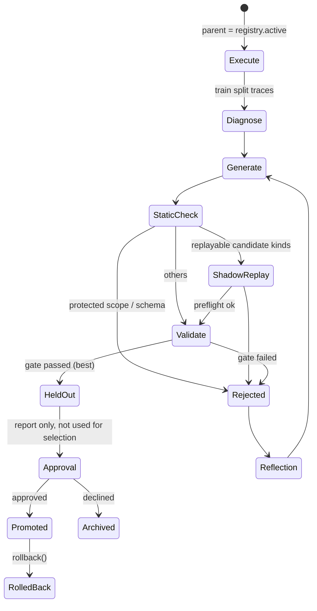

# Interface: Improvement (Evolution Layer)

> Package: `wc-evolve` **[Validated in prototype]**
> Based on: `../../research/comparisons/rsi-comparison.md`

## 1. Closed loop and split discipline



| Split | Purpose | May read privileged information? |
|---|---|---|
| train | diagnosis, candidate generation | yes |
| validation | **candidate selection** (paired gate) | no (requires deployment-equivalent observations) |
| heldout | **report only**, `used_for_selection=false` | no |

## 2. Data types and protocols

```python
class Candidate(Contract):
    patch: Mapping[str, Any]          # v0.1: dotted-path config patch, e.g. {"agent.params.kp": 2.0}
    rationale: str
    parent_id: str | None             # must equal registry.active at promotion time (prevents stale candidates)
    generator: str                    # "name@version"
    kind: str = "config_patch"        # v0.2: "critic_rule" | "recovery_rule" | "prompt" | "skill" | "policy_ref"
    evidence: Mapping[str, Any]       # diagnostic references (bucket, episode ids)
    id: str
    def digest(self) -> str

class Proposer(Protocol):                                             # the `generators` contract (core.improvement)
    name: str
    def propose(self, diagnosis: Mapping[str, Any], cfg: ExperimentConfig, parent_id: str | None,
                archive: list[ArchiveEntry]) -> list[tuple[Candidate, str]]    # (candidate, hypothesis)

def diagnose(result: EvalResult) -> FailureReport                     # deterministic bucketing; v0.2 layers on LLM multi-hypothesis diagnosis
def check_protected_scope(c: Candidate) -> None                       # violation → ProtectedScopeViolation
def run_cycle(base_cfg, registry, archive, proposer, evaluate, diagnose, *, protocol, approve) -> CycleReport
                                                                      # campaigns: cascade + sequential gate (RFC-0002)
def improvement_cycle(base_cfg, registry, proposer, evaluate, *, approve) -> CycleReport
                                                                      # one cycle on train / validation / heldout splits

class CandidateRegistry:
    def register(c); def promote(id, *, gate, approved_by); def reject(id, *, gate)
    def rollback(*, reason, by) -> str | None
    def lineage() -> list[str]; def effective_patch() -> dict; def ledger() -> list[dict]
    active: str | None
```

## 3. Validation gate (Gate)

A candidate passes only if it satisfies **all** of the following:

1. Paired comparison (same TaskInstance.key), one-sided exact McNemar `p < alpha` (default 0.05).
2. Overall success rate is not lower than the parent version.
3. The increase in mean safety interventions does not exceed `max_safety_increase` (default 0).
4. Regression suite: no single task's success rate drops by more than `max_task_regression` (default 0.1).
5. (v0.2) Cross-benchmark regression: no degradation on the registered set of regression benchmarks.
6. (v0.2) Latency budget: `latency_p95` does not exceed the budget.

## 4. Protected scope (Protected Scope)

Config prefixes a candidate **must not** modify: `safety`, `benchmark`, `trace`, `scorers`, `evolution`, `schema_version`, `env` **[Validated in prototype]**.
Reason: to prevent "raising the score by relaxing safety constraints or modifying the evaluation". In the prototype demo, an adversarial generator proposing `safety.max_delta: 10.0` is rejected outright.

Additionally (implemented in v0.2, not covered by the prototype):
- Candidate kind allowlist; code-type candidates (code inside a `skill`) may only execute in a subprocess/container with no network and a read-only filesystem, and the actions they produce still go through the SafetyShield.
- During the LLM generation phase, access to Traces and diagnostics is read-only, with no shell/write permission (compare Zetta/RPent, which default to full access).
- Promotion for real-robot deployment requires mandatory human approval (the `approve` callback cannot be disabled by a candidate or by config).

## 5. Registry and Rollback

- Versions are immutable: `versions/<id>.json` (including digest, parent).
- `ACTIVE` pointer; `effective_patch()` composes patches along the lineage from oldest to newest.
- All operations are written to an append-only `ledger.jsonl`: `register / promote / reject / rollback` **[Validated in prototype]**.
- The online Agent only reads the active version and writes it into the Run Manifest at startup.

## 6. Prototype demo results (`examples/rsi_demo.py`)

| Step | Result |
|---|---|
| Parent version (kp=0.5) train / validation | success 0.033 / 0.083 |
| Diagnosis | `{timeout_far: 13, timeout_near: 16}` |
| Adversarial candidate `safety.max_delta=10` | **rejected** (protected scope) |
| Candidates kp=1 / 2 / 4 validation | 0.767 / 1.000 / 1.000, all pass the gate |
| kp=2 selected, held-out (report only) | 1.000 vs parent 0.050, 57:0, p≈7e-18 |
| promote → rollback | effective patch `{kp: 2.0}` → `{}`; ledger records the rollback |

Note: this demo validates the **process and interfaces**; gain tuning on the test double (and on MuJoCo reach) does not represent the real difficulty of RSI.
