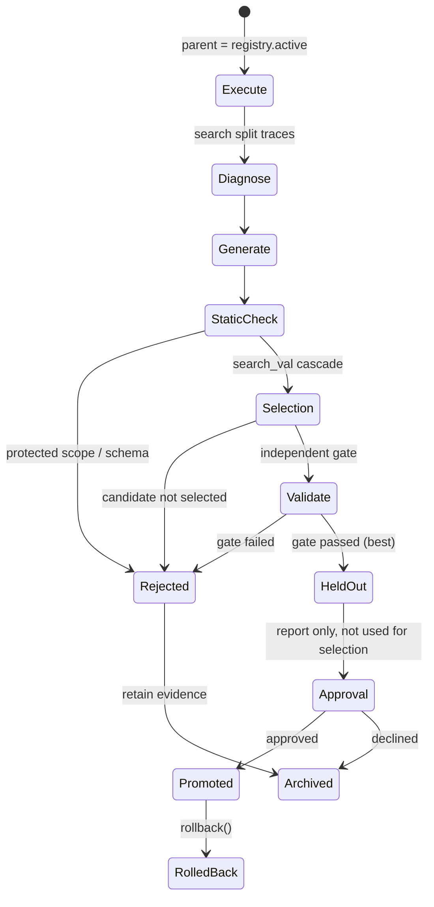

# Interface: Improvement (Evolution Layer)

> Package: `hylo-evolve` **[Validated in prototype]**
> Based on: `../../research/comparisons/rsi-comparison.md`

## 1. Closed loop and split discipline



| Split | Purpose | Data boundary |
|---|---|---|
| search | diagnosis and candidate development | deployment observation requirements depend on the configured tools and diagnosis |
| search_val | candidate screening and selection | separate from search cases |
| gate | confirmatory paired test | separate from candidate development and selection |
| heldout | report only | not used for candidate selection |

This is the current `run_cycle` campaign protocol. The older `improvement_cycle` prototype
uses train/validation/heldout; its example results below should not be read as the current
four-split protocol. Proposers receive the archive and must control what reaches a model;
the interface itself does not isolate arbitrary plugins from historical evaluation fields.

## 2. Data types and protocols

```python
class Candidate(Contract):
    patch: Mapping[str, Any]          # v0.1: dotted-path config patch, e.g. {"agent.params.kp": 2.0}
    rationale: str
    parent_id: str | None             # must equal registry.active at promotion time (prevents stale candidates)
    generator: str                    # "name@version"
    kind: str = "config_patch"        # enabled: config_patch or code; other enum values remain disabled
    evidence: Mapping[str, Any]       # diagnostic references (bucket, episode ids)
    id: str
    def digest(self) -> str

class Proposer(Protocol):                                             # the `generators` contract (core.improvement)
    name: str
    def propose(self, diagnosis: Mapping[str, Any], cfg: ExperimentConfig, parent_id: str | None,
                archive: list[ArchiveEntry]) -> list[tuple[Candidate, str]]    # (candidate, hypothesis)

def diagnose(result: EvalResult) -> FailureReport                     # deterministic bucketing; v0.2 layers on LLM multi-hypothesis diagnosis
def check_protected_scope(c: Candidate) -> None                       # violation → ProtectedScopeViolation
def run_cycle(base_cfg, registry, archive, proposer, evaluate, diagnose, *, protocol, approve) -> CycleReport
                                                                      # campaigns: cascade + sequential gate (RFC-0002)
def improvement_cycle(base_cfg, registry, proposer, evaluate, *, approve) -> CycleReport
                                                                      # one cycle on train / validation / heldout splits

class CandidateRegistry:
    def register(c); def promote(id, *, gate, approved_by); def reject(id, *, gate)
    def rollback(*, reason, by) -> str | None
    def lineage() -> list[str]; def effective_patch() -> dict; def ledger() -> list[dict]
    active: str | None
```

## 3. Validation gate (Gate)

After selection, the current campaign checks:

1. A paired gate test on matching episode keys. The default is one-sided exact McNemar on
   success, with `alpha=0.05`, Holm correction across selected candidates and optional
   alpha spending across configured gate looks. A custom `gate_test` can select another metric.
2. Per-task success regression no greater than `max_task_regression` (default `0.15`).
3. Mean safety-intervention increase no greater than `max_safety_increase` (default `1.0`).

The default success test requires evidence favoring the candidate; arbitrary gate plugins
have their own comparison semantics. A general cross-benchmark regression suite and a
`latency_p95` promotion veto are not implemented by `ProtocolConfig`. The older prototype
has different defaults. See `hylo.evolve.protocol.ProtocolConfig` for current options.

## 4. Protected scope (Protected Scope)

Config prefixes a candidate **must not** modify: `safety`, `benchmark`, `trace`, `scorers`, `evolution`, `schema_version`, `env` **[Validated in prototype]**.
Reason: to prevent "raising the score by relaxing safety constraints or modifying the evaluation". In the prototype demo, an adversarial generator proposing `safety.max_delta: 10.0` is rejected outright.

Current implementation boundaries:

- The kind allowlist enables `config_patch` and `code`. Code candidates may change only the
  agent, cannot contain inline source and must reference a sealed program artifact.
- Code agents use the configured restricted Python namespace and tool path. This is not a
  universal subprocess/container, read-only-filesystem or network-isolation guarantee for
  arbitrary proposer plugins. Observation permissions depend on the toolkit.
- `EvolveConfig.approval` defaults to `auto`. Configure `manual` for reviewed deployment;
  a passing candidate then waits for explicit approval. The campaign does not independently
  detect hardware and force that setting.

## 5. Registry and Rollback

- Versions are immutable: `versions/<id>.json` (including digest, parent).
- `ACTIVE` pointer; `effective_patch()` composes patches along the lineage from oldest to newest.
- All operations are written to an append-only `ledger.jsonl`: `register / promote / reject / rollback` **[Validated in prototype]**.
- The online Agent only reads the active version and writes it into the Run Manifest at startup.

## 6. Prototype demo results (`examples/rsi_demo.py`)

| Step | Result |
|---|---|
| Parent version (kp=0.5) train / validation | success 0.033 / 0.083 |
| Diagnosis | `{timeout_far: 13, timeout_near: 16}` |
| Adversarial candidate `safety.max_delta=10` | **rejected** (protected scope) |
| Candidates kp=1 / 2 / 4 validation | 0.767 / 1.000 / 1.000, all pass the gate |
| kp=2 selected, held-out (report only) | 1.000 vs parent 0.050, 57:0, p≈7e-18 |
| promote → rollback | effective patch `{kp: 2.0}` → `{}`; ledger records the rollback |

Note: this demo validates the **process and interfaces**; gain tuning on the test double (and on MuJoCo reach) does not represent the real difficulty of RSI.

## 7. Phase-guided program evolution

The optional `harness.program` generator in `hylo-code-agents` independently implements a
HarnessPAI-inspired strategy: propose an observable phase plan, repair an executable program
on development cases, then seal the program together with evidence-linked repair notes.
Completed program revisions are evaluated automatically within the submission budget;
unchanged revisions and explicit submissions are not duplicated.
It reuses the existing campaign gate and registry; solving development cases does not
activate the candidate. No upstream HarnessPAI code is included.

`PhaseRepairMemory` retrieves notes only from active promoted program lineages. A note
must cite failed and successful development replays of the same case, and its content is
covered by the program artifact digest. Rollback removes the retired branch from recall.
The containing program has gate evidence; transfer of an individual note remains unverified.
Phase completion and handover logic are generated code, not a centrally interpreted phase
graph. A frozen VLA can only be called through a toolkit that actually exposes one.

Implementation, configuration and verification details are maintained in
`adapters/hylo-code-agents/examples/harness_evolution/README.md`.
