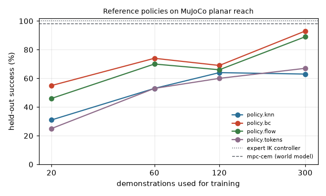

# Agent examples

Agents that run any policy, choose with any reasoner and evaluate candidates without letting them act
(`hylo-agents`, `hylo-reasoners`, `hylo-reasoner-llm`, `hylo-policies`). Each script measures one effect on MuJoCo
reach or table tasks (from hylo-bench, referenced by registry name only), writes `result.json` and prints a results
table. Run from the repository root:

```bash
uv run python examples/agents/01_chunk_execution.py [--quick] [--out DIR] [--workers N]
```

Output goes to `runs/examples/agents/<slug>/` (traces, artifacts, `result.json`); `--quick` runs a small version in
under a minute. Numbers below are from full runs on 2026-11-01 (128-core CPU, no GPU, 16 worker processes);
policies are evaluated on held-out init states that no learner saw.

| Example | What it shows | Command | Measured result | Runtime |
|---|---|---|---|---|
| `01_chunk_execution.py` | one policy, four execution strategies by config: open loop, replan interval, ACT temporal ensemble | `uv run python examples/agents/01_chunk_execution.py` | policy.bc: open loop 90%, replan every 4 steps 93%, every step **81%** (+4/-13 vs open loop, p = 0.05), temporal ensemble 93% with 31% smoother actions (jerk 0.054 vs 0.078) at 4.8x the policy queries; policy.flow: 88% open loop, 93% ensembled; other differences within the 95% intervals | 50 s (quick 10 s) |
| `02_reasoner_swap.py` | the same agent with a rule, LLM or VLM chooser, one config line apart (table reach, language goals, pads visible for 5 steps) | `uv run python examples/agents/02_reasoner_swap.py` | rule chooser 76.7% (indirect phrasing 30%); `chooser.llm` qwen3.5:35b-a3b **100%**, 2.3 s per decision; gpt-oss:20b 100%, 2.6 s; `chooser.vlm` (top-camera image only) 100%, 2.0 s; no-language baseline 0% (60 episodes each) | 5 min live, 15 s cached (quick 10 s) |
| `03_reference_policies.py` | reference policies trained from your own runs: leaderboard and data efficiency | `uv run python examples/agents/03_reference_policies.py` | expert 100%, mpc-cem 98%, bc + temporal ensemble 93%, bc 93%, flow + steering 92%, flow 89%, tokens 67%, knn 63%; from 20 demonstrations: bc 55%, flow 46%, knn 31%, tokens 25% | 70 s (quick 16 s) |
| `04_shadow_agent.py` | candidates run in shadow next to the acting IK controller: disagreement, no actions sent, latency | `uv run python examples/agents/04_shadow_agent.py` | executed actions identical to the controller alone in all 7 shadow runs (3747 decisions each); disagreement does **not** predict how a candidate acts (Spearman -0.15): flow is closest to the controller (mean abs. difference 0.022) yet acts worse than bc (89% vs 93%); a CEM-MPC shadow adds 7.1 ms per decision inline, 0.03 ms in the background | 75 s (quick 16 s) |

## Chunk execution

policy.bc and policy.flow (chunks of 8 actions, 300 demonstrations), 100 held-out episodes per row; jerk = mean
`|a_t - a_(t-1)|`; "vs open loop" = episodes won / lost against the same policy run open loop, exact two-sided
McNemar test on the same seeds.

| policy | strategy | success % | 95% CI | steps | queries / episode | jerk | vs open loop |
|---|---|---|---|---|---|---|---|
| bc | open loop (8) | 90 | 83-94 | 49.1 | 9.6 | 0.078 | - |
| bc | replan every 4 | 93 | 86-97 | 46.6 | 14.7 | 0.083 | +6/-3, p 0.51 |
| bc | replan every 2 | 88 | 80-93 | 51.4 | 27.7 | 0.087 | +6/-8, p 0.79 |
| bc | replan every 1 | 81 | 72-88 | 58.8 | 58.8 | 0.066 | +4/-13, p 0.05 |
| bc | temporal ensemble m=0.01 | 93 | 86-97 | 45.7 | 45.7 | 0.054 | +4/-1, p 0.38 |
| bc | temporal ensemble m=0.5 | 90 | 83-94 | 49.5 | 49.5 | 0.054 | +3/-3, p 1.00 |
| flow | open loop (8) | 88 | 80-93 | 50.6 | 7.2 | 0.082 | - |
| flow | replan every 1 | 90 | 83-94 | 49.1 | 49.1 | 0.081 | +7/-5, p 0.77 |
| flow | temporal ensemble m=0.01 | 93 | 86-97 | 45.3 | 45.3 | 0.061 | +7/-2, p 0.18 |

Receding horizon with one step is the worst choice for the deterministic BC policy here; averaging overlapping
chunks is the best for both policies and the smoothest, but the planar reach task has no disturbances, so the gains
are small. `result.json` has every row, including flow with replan intervals 4 and 2.

## Reasoner swap

The agent is `composable.object_reach` in every row; only `chooser:` changes. Grounding accuracy (the first choice is
the instructed pad, checked against the trace's privileged state) equals the success rate in every row: once the
right pad is chosen, spatial memory and the IK policy always finish the task. The rule chooser understands colour
words only; for indirect phrasing ("the colour of a ripe tomato") it falls back to the nearest pad (30%, about
chance with three pads). Latency is the median of live calls, one at a time, on the CPU Ollama server; 20 of the 60
calls per LLM row are answered from the cache because the push task shares its scenes with the direct task.

## Reference policies

<p align="center"></p>

Demonstration subsets are balanced over the two tasks (the search split of a smaller protocol, whose seeds are a
prefix of the full one's). The curve is not monotonic (bc 74% at 60, 69% at 120 demonstrations): neighbouring
points overlap within their intervals. The MPC planner uses a world model learned from expert and random-action runs
and costs 7 ms per decision against 0.05 ms for bc. Compare with `bench/examples/policies` for the same families
scored under the mujoco-reach benchmark protocol.

## Shadow agent

| candidate (in shadow) | mean abs. difference | decisions with max difference > 0.25 | acting: success % | acting: steps |
|---|---|---|---|---|
| policy.flow (from its runs) | 0.022 | 0.6% | 89 | 49.4 |
| policy.knn (from its runs) | 0.030 | 4.2% | 63 | 77.0 |
| policy.bc (from its runs) | 0.033 | 0.9% | 93 | 46.6 |
| IK controller kp=0.1 | 0.097 | 30.5% | 100 | 46.9 |
| IK controller kp=0.03 | 0.325 | 82.3% | 100 | 107.3 |
| mpc-cem (world model) | 0.442 | 83.6% | 100 | 42.8 |
| random actions | 0.826 | 96.3% | 0 | 150.0 |

In shadow, a candidate only ever sees the states the acting agent produces, so the imitation policies look close to
it while their compounding errors when acting (knn: 63%) stay invisible, and good controllers that act differently
(MPC, slower gains) look far. Shadow disagreement tells where a candidate would act differently, not whether it is
better; promotion still needs the gate.
