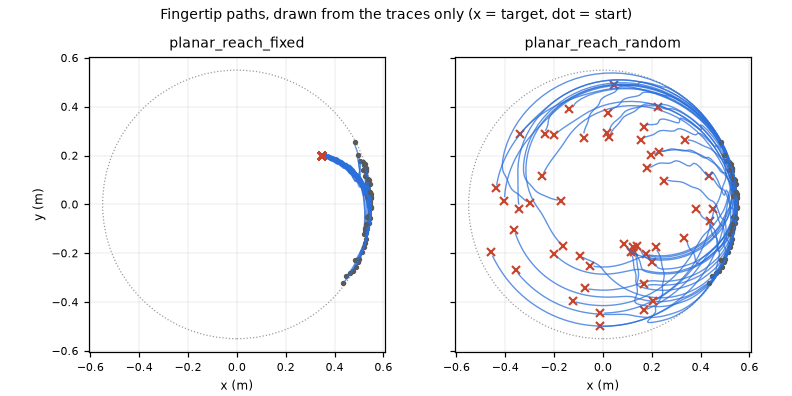
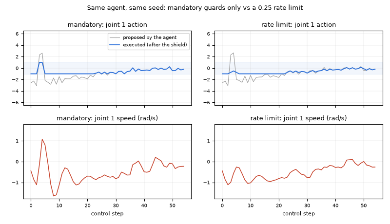
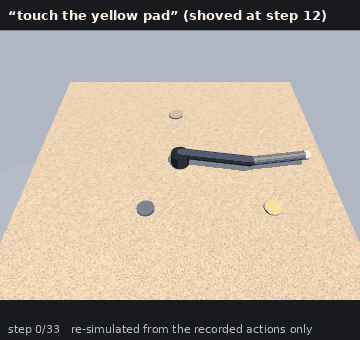
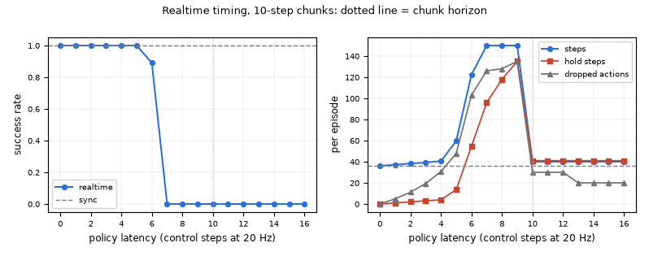

# Core examples

Six small scripts, one per capability of `hylo-core`: the kernel, the SafetyShield, traces and replay, remote
components and the wire codecs, conformance with sealed artifacts and the store, and the kernel's timing modes with
the operator channel. Each script runs real episodes, measures something, prints a short results table and writes
`result.json`.

The environments are the MuJoCo tasks of hylo-bench (`mujoco.planar_reach`, `mujoco.table_reach`, from
`hylo-env-mujoco`). The scripts refer to them only by their registry name, so they need that package installed in
the venv. The development workspace installs it.

## Running

From the harness repository root:

```bash
uv run python examples/core/01_first_episode.py            # full run
uv run python examples/core/01_first_episode.py --quick    # under 60 s (here: 2-3 s)
uv run python examples/core/01_first_episode.py --out /tmp/x
uv run pytest tests/test_examples_core.py                  # every example with --quick
```

Output goes to `runs/examples/core/<slug>/` (gitignored): `result.json`, any figure, and the run directories with
their traces. Seeds are fixed, so the numbers below reproduce, except wall-clock timings.

## Results

Full runs on 2026-11-01, on a 128-core CPU with no GPU.

| Example | What it shows | Command | Measured result | Runtime |
|---|---|---|---|---|
| [01_first_episode](01_first_episode.py) | One episode through `EpisodeRunner` by hand, then a whole split as an `ExperimentConfig` (`run_experiment`, as `hylo run` does), `hylo trace`, a second identical run | `uv run python examples/core/01_first_episode.py` | Episode by hand: success in 30 steps, final distance 0.0195 m, 183 trace events (8 types), guards `finite -> bounds`. Experiment, 100 episodes on 8 workers: success 1.00, 36.2 steps on average (fixed target 30.0, random 42.4), 1.4 s. Second run: same status and steps on 100/100 episodes, largest action difference 0 | 4 s |
| [02_safety_shield](02_safety_shield.py) | A noisy agent with spikes up to 5x the bounds, under the mandatory guards, a rate limit (`max_delta: 0.25`), and `norm_limit` + `delta_limit` in both orders, with a well-behaved control agent. Then four ways to try to get around the shield | `uv run python examples/core/02_safety_shield.py` | 100 episodes per config. Proposed actions reach 9.42 and executed ones never pass 1.00. Largest step-to-step jump of the executed action: 2.00 with the mandatory guards, 0.25 with a rate limit. Peak joint speed 2.52 -> 1.66 rad/s, peak acceleration 32.7 -> 14.2 rad/s² (norm+rate: 1.31 rad/s, 13.8 rad/s²). In the wrong order (`max_delta` first, then `norm_limit`) the jump reaches 0.28. Success stays 1.00 in every config. Control agent: 3.0 interventions per episode. Bypass attempts: a guard plugin that multiplies actions by 10 still gives max \|a\| 1.00, a NaN ends the episode as `safety_abort` (every action that reached the env was finite), guard order stays `finite -> ... -> bounds`, and a real-robot shield aborts at the first proposal | 12 s |
| [03_trace_replay](03_trace_replay.py) | A language + memory agent on the MuJoCo table, every episode re-simulated from its recorded actions alone, a 1e-9 sensitivity check, and a replay GIF rendered from the trace | `uv run python examples/core/03_trace_replay.py` | 90 episodes, 3985 steps, success 0.77. Traces: 10.7 MiB, 2.8 KB per step, 11 event types (including 759 `memory.retrieval` and 180 `agent.decision`). Replay: 90/90 episodes bit-exact, largest observation and reward deviation 0, same outcomes, 2709 steps/s. First action changed by 1e-9: 0/90 episodes stay bit-exact (largest deviation 5.6e-10) | 8 s |
| [04_remote_env](04_remote_env.py) | The same experiment in five placements: in-process, stdio env, stdio env + agent, WebSocket env, WebSocket env + agent. Latency of a single step call, and the two wire codecs | `uv run python examples/core/04_remote_env.py` | 50 episodes, 1840 steps per placement, identical everywhere: same status and steps, largest action difference 0. Time per step inside episodes: 0.126 ms in-process, +0.105 ms stdio env, +0.239 ms stdio env + agent, +0.326 ms ws env, +0.747 ms ws env + agent. Single `env.step` call, median: 22 µs direct, 63 µs through stdio, 161 µs through WebSocket. One step on the wire: 152 B request, 644 B reply. Observation with a 224x224 image: 196 KiB and 0.63 ms (JSON codec) vs 147 KiB and 0.017 ms (msgpack wire) | 8 s |
| [05_conformance_artifacts](05_conformance_artifacts.py) | `hylo conformance --agent` in-process and over stdio, the kit on a broken environment, a dataset artifact sealed from a run, `hylo artifact` before and after a 1-bit change, the split guard, store ids, references and deletion protection | `uv run python examples/core/05_conformance_artifacts.py` | Conformance: 10/10 checks pass in-process. Over stdio 9 pass and 1 is skipped (snapshot). BrokenEnv: 2 of 7 checks fail (seeded reset, snapshot/restore). Artifact `reach-pairs@d2d609810e833160`: 371 pairs, sealed in 0.5 ms, verified in 0.2 ms. One flipped bit: `hylo artifact` exits 1 (digest mismatch); with the bit restored it exits 0. Sealing a gate-split build is refused. The artifact id resolves only while the content matches, and `hylo store rm` of the source run exits 1 because the artifact refers to it | 3 s |
| [06_realtime_timing](06_realtime_timing.py) | `sync` vs `realtime` timing (virtual clock) for an agent that plans 10-step chunks, over a policy latency of 0 to 0.8 s, then an e-stop through the `OperatorChannel` | `uv run python examples/core/06_realtime_timing.py` | 100 episodes per timing. Sync: success 1.00, 36.2 steps. Realtime: success 1.00 up to a 5-step latency (59.7 steps, 13.6 holds), 0.89 at 6 steps, 0.00 from 7 steps (150-step timeouts). From 10 steps (the chunk horizon) every episode ends in a watchdog abort. E-stop posted after step 10: `safety_abort` at step 10 with no action sent after it. The next episode is refused (latched fault). After `clear_fault`: success in 51 steps | 40 s |

## Figures

Fingertip paths of the 100 episodes in example 01, drawn from the traces only:



Example 02, same seed: the agent's proposals (grey) and what the shield let through (blue), with the joint speed
that resulted. A spike at step 23 becomes a full reversal with the mandatory guards only. The rate limit removes it:



Example 03: an episode of the table task (shoved at step 12), re-simulated from the recorded actions and rendered
with MuJoCo on OSMesa:



Example 06: success and per-episode counts against policy latency:



## Findings

- **A WebSocket placement changes the config digest.** `ExperimentConfig.measured()` drops `env.remote` and a
  remote agent's runtime, so a stdio env has the same digest as in-process (`05c573fe1309dd6d`). A WebSocket env
  is `{type: remote.ws, params: {url}}` instead, so the digest changes, and it includes the URL: with `--port 0` it
  is different on every run. A stdio agent (`type: remote`) also gets its own digest. Results do not depend on
  placement (example 04), so comparing runs by digest across placements does not work today.
- **Guard order matters.** Guards run in the order they are listed, and the `max_delta` shorthand is always
  inserted first. With `max_delta` plus a `norm_limit` guard, the norm scaling runs after the rate limit and
  produces step-to-step jumps of up to 0.28, above the 0.25 limit. Listing `norm_limit` and then `delta_limit` as
  guard plugins keeps the jumps at 0.25 (example 02, both orders measured).
- **The unsafe stream does not lower success here.** On planar reach the noisy agent succeeds in every config. What
  the shield changes is the motion: smaller steps, lower peak speed, lower peak acceleration. Interventions count
  every modified step, so a stricter config shows more interventions.
- **Realtime fails well before the latency reaches the chunk horizon.** With 10-step chunks, success drops to 0 at
  a 7-step latency, not at 10. The aligned merge drops the first t - s actions of a chunk, which assumes the robot
  followed the previous plan in the meantime. While the queue is empty the robot holds instead, and the rest of a
  P-controller rollout is small, so the arm only crawls. The watchdog catches the case where nothing is left to
  execute (latency of 10 steps or more).
- **The stdio env proxy has no snapshot/restore.** `RemoteEnvironment` does not forward `snapshot`/`restore`, so
  that conformance check is skipped over stdio. In-process, MuJoCo passes it.
- **Reusing an episode id appends to its trace file.** `TraceStore` opens episode files in append mode. The scripts
  that use fixed episode ids clear their trace directory first.
