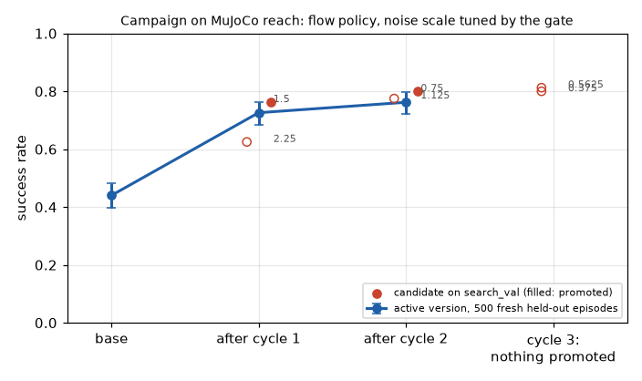
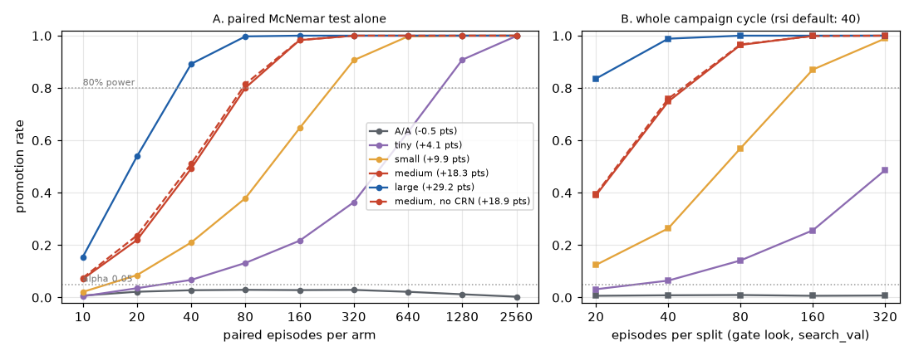

# Evolution examples

Runnable examples of the evolution layer (`hylo-evolve`, the paired statistics of `hylo-eval`, `hylo-proposer-llm`)
on MuJoCo planar reach. Each script shows one capability and measures its effect. All run from the harness
repository root, write `result.json` and print a results table:

```bash
uv run python examples/evolve/01_campaign_reach.py [--quick] [--out DIR]
```

The default output directory is `runs/examples/evolve/<slug>/`. `--quick` finishes in under a minute. The MuJoCo
environment comes from hylo-env-mujoco (hylo-bench) and is referenced only by its registry name,
`mujoco.planar_reach`. Large evaluations run in up to `--workers` processes (default 24).

Most examples improve one parent: a flow-matching policy trained in the script from 120 IK-expert demonstrations
(the `search` and `search_val` init states, as in hylo-bench's `examples/policies`), run with too much sampling noise
(`noise_scale: 3.0`, about 45% success). Gate and held-out init states are never used for training.

## Results

Measured on 2026-11-01 on a 128-core CPU without a GPU, full mode (no `--quick`).

| Example | What it shows | Command | Measured result | Runtime |
|---|---|---|---|---|
| [01_campaign_reach.py](01_campaign_reach.py) | A full campaign (`run_campaign`): diagnosis, `rule.gain` candidates, cascade, 2-look gate, held-out report, promotion, cycle after cycle; then every version on fresh episodes | `uv run python examples/evolve/01_campaign_reach.py` | 3 cycles, 2 promotions (noise 3.0 → 1.5 → 0.75), stopped when cycle 3 found nothing better. On 500 fresh held-out episodes: 0.440 → 0.726 → 0.762 (vs base 190:29, p = 1.7e-30) | 48 s |
| [02_protected_scope.py](02_protected_scope.py) | Adversarial candidates (loosen safety, change benchmark, trace, env, gate settings, `code` kind, doctored artifacts, duplicates) refused at stage 0 | `uv run python examples/evolve/02_protected_scope.py` | Removing the speed limit would raise success 0.505 → 1.000 (counterfactual run outside the gate). 11 of 14 candidates refused before any rollout, 0 episodes spent on them. Gap found: a behaviour artifact forged as `mutable` passes stage 0 | 16 s |
| [03_gate_power.py](03_gate_power.py) | False promotions of an A/A change vs alpha, and power against the number of episodes, for the paired test and for the whole campaign cycle | `uv run python examples/evolve/03_gate_power.py` | A/A promoted in 0.3–2.9% of draws (test alone) and 0.6–0.9% of whole cycles (alpha 0.05). At the default split sizes (40 episodes per split) the cycle promotes +29 pts 99%, +18 pts 75%, +10 pts 26%, +4 pts 6.5% of the time. 80% power needs 80 pairs for +18 pts, 320 for +10, 1280 for +4 | 1.5 min |
| [04_field_rollback.py](04_field_rollback.py) | Manual approval, deployment through `active.json`, a field monitor, `rollback()` | `uv run python examples/evolve/04_field_rollback.py` | The gate promoted noise 1.0 in simulation (0.450 → 0.805). In the 10 Hz field cell it regressed (parent 0.265, candidate 0.055). The monitor fired after 40 field episodes (0:8 discordant pairs, p = 3.9e-3) and rolled back to the base version | 34 s |
| [05_llm_vs_rule.py](05_llm_vs_rule.py) | `llm.steering` (qwen3.5:35b-a3b via Ollama) against `rule.steering` and `rule.gain`, 2 cycles of at most 3 candidates each | `uv run python examples/evolve/05_llm_vs_rule.py` | Each promoted once. On 500 fresh held-out episodes (parent 0.496): LLM 0.724 (noise 1.5, the same candidate `rule.gain` found), `rule.gain` 0.724, `rule.steering` 0.542 (4-sample vote; vs parent p = 0.07). The LLM used 2 calls (26–28 s each), 520 episodes, and 3 of its 6 proposals were invalid | 2 min |



*01: the active version after each cycle on 500 fresh held-out episodes (95% Wilson intervals). Circles are the
candidates on `search_val`; filled circles were promoted.*

## The gate's power

The project's main open problem is power. `03_gate_power.py` runs each arm once on 6000 episodes
(2 tasks × 3000 fresh seeds), then replays gate decisions on random subsets of those episodes:



*Left: the one-sided exact McNemar test alone. Right: the whole campaign cycle (`run_cycle`) at 0.5× to 8× the default
split sizes. Effects are the arms' true differences on the pool.*

| Arm | True effect | Pairs for 80% power (test alone) | Whole cycle, default sizes |
|---|---|---|---|
| A/A (fresh noise stream, same policy) | −0.5 pts | never (false promotions 0.3–2.9%) | 0.9% |
| noise 2.75 | +4.1 pts | 1280 | 6.5% |
| noise 2.5 | +9.9 pts | 320 | 26.4% |
| noise 2.0 | +18.3 pts | 80 | 74.9% |
| noise 1.0 | +29.2 pts | 40 | 98.9% |

The gate is safe: the A/A change is promoted far less often than alpha, because the exact test is conservative and
the cycle adds a screen and alpha spending. It is also underpowered: a 10-point gain, the size most real
improvements have, is confirmed in about one cycle in four at the default 40 episodes per split. On
LIBERO-10 (recorded, `docs/research/experiments/2026-10-30-libero10-rsi-cycle1.md`) a candidate that helped by 8 to
12 points on three disjoint sets of init states failed the gate at p = 0.068 for the same reason.

Common random numbers (parent and candidate share seeded policy noise) did not help here: the same +18-point effect
on a fresh noise stream has the same power. The policy's trajectories diverge too quickly for shared noise to keep
outcomes correlated.

## Notes

- `03_gate_power.py` replays decisions on a finite pool of real episodes (a bootstrap). As the number of pairs nears
  the pool size, rates converge to the pool's realised difference. That is why the A/A rate drifts down at 1280 and
  2560 pairs.
- `04_field_rollback.py` simulates the field as a different control rate (10 Hz instead of 20 Hz). The flow policy was
  trained on 20 Hz data. The lower-noise candidate is better in simulation and much worse in the field. The monitor
  pairs each field episode with the parent's recorded field baseline on the same task instance and tests one-sided at
  0.01 per look (10 looks at most, so at most 0.1 overall by the union bound).
- `05_llm_vs_rule.py` caches LLM replies under `<out>/llm-cache`, so a rerun into the same directory reproduces the
  proposals without the model. It needs an Ollama server at `http://localhost:11434` (`--model`, `--base-url`). Without
  one, the LLM arm is skipped and reported in `result.json`. One run per generator: this does not show that either kind
  of generator is better. On this task the best single change is a smaller noise scale, which a one-knob rule finds
  directly. The LLM's steering prompt is written for LIBERO grippers. All 3 invalid proposals were trigger rules without
  the required `name` field, which the prompt does not mention. The LLM latencies (26–28 s per call) are from the
  first, uncached run; `result.json` of a cached rerun records 0 calls.
- Shadow mode (`shadow_config`) is not covered. Its divergence report treats the last action dimension as a gripper,
  which does not fit the 2-dimensional joint actions of planar reach.
