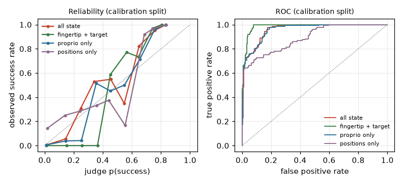
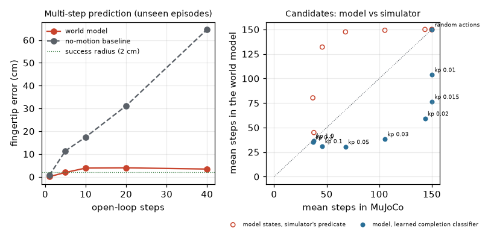

# Instrument examples

Instruments measure or predict but never act (`hylo-instruments`): success judges, world models and chunk value
models, trained by `hylo-learn` jobs from your own runs. Each script trains an instrument on MuJoCo planar reach
(from hylo-bench, referenced by registry name only), where the simulator's verdict is known, checks the instrument
against it, writes `result.json` and prints a results table. Run from the repository root:

```bash
uv run python examples/instruments/01_success_judge.py [--quick] [--out DIR] [--workers N]
```

Output goes to `runs/examples/instruments/<slug>/`; `--quick` runs a small version in under a minute. Numbers below
are from full runs on 2026-11-01 (128-core CPU, no GPU, 16 worker processes).

| Example | What it shows | Command | Measured result | Runtime |
|---|---|---|---|---|
| `01_success_judge.py` | `judge.trace` trained on development runs, calibrated (`hylo calibrate`) on unseen runs against the simulator outcome; four choices of what the judge observes | `uv run python examples/instruments/01_success_judge.py` | fingertip + target: **AUC 0.986** (random-target task 0.974), recall 0.69 at precision 0.95; all state: AUC 0.960 (0.884): with joint velocities it learns a termination shortcut instead of the target; proprio only 0.958; positions only 0.889 (0.697); 400 calibration episodes, base rate 0.36 | 80 s (quick 14 s) |
| `02_world_model.py` | `world_model.state` fitted from runs, used as an environment (`env: {type: world_model}`) to rank 9 controllers, compared with MuJoCo | `uv run python examples/instruments/02_world_model.py` | open-loop fingertip error 3.9 cm after 10 steps (no-motion baseline 17.5 cm); ranking vs MuJoCo: Spearman **0.91** on success, 0.83 on mean steps; but optimistic (kp 0.01: 80% in the model, 0% real) and it picks kp 0.1 as best where MuJoCo picks kp 0.3 | 1 min (quick 9 s) |
| `03_chunk_critic.py` | a chunk value model (ChunkCritic) from flow-policy traces: offline accuracy and steering with it (CriticSteeredAgent) | `uv run python examples/instruments/03_chunk_critic.py` | null result: AUC 0.828 for state + chunk vs 0.831 for state alone; same-state pair accuracy 0.61 +- 0.05 (n = 102); online, critic selection 88% vs medoid 92% (+3/-7, p = 0.34) on 100 held-out episodes | 90 s (quick 12 s) |

## Success judge

<p align="center"></p>

Training data: IK controllers too slow for the 150-step budget (kp 0.015, 0.02, 0.03) and random actions, 800
`search` episodes; calibration: the 400 `search_val` episodes, which no judge saw.

| judge observes | AUC | AUC, fixed target | AUC, random target | Brier | ECE | threshold for precision 0.95 | recall there | ready to label |
|---|---|---|---|---|---|---|---|---|
| fingertip + target | 0.986 | 0.998 | 0.974 | 0.066 | 0.120 | 0.661 | 0.69 | yes |
| all state (joints, velocities, fingertip, target) | 0.960 | 0.992 | 0.884 | 0.085 | 0.091 | 0.635 | 0.68 | yes |
| proprio only (no target) | 0.958 | 0.993 | 0.873 | 0.088 | 0.084 | 0.613 | 0.68 | yes |
| positions only (no velocities, no target) | 0.889 | 0.987 | 0.697 | 0.137 | 0.142 | 0.620 | 0.63 | yes |

Given every state entry, the judge does no better than without the target: successful episodes end the moment the
fingertip arrives, still moving, so joint velocity separates the outcomes on the training distribution and the
judge never learns the target relation. Without velocities and target it falls to 0.70 on random targets. The same
trap as episode length in LIBERO (hylo-docs, success judges on LIBERO-10): choose what a judge may observe by what
decides the task, then calibrate it. The labelling workflow with a calibrated judge is in `examples/learn`.

## World model

<p align="center"></p>

Model: 3-member ensemble, 37189 transitions from 300 expert and 300 random-action episodes (29 s to train); one-step
validation MSE 7.2e-3 against 2.95e-2 for predicting no change. Candidates on the `gate` split, 100 episodes each:

| candidate | MuJoCo success % | model success % | model states, simulator predicate % | MuJoCo steps | model steps |
|---|---|---|---|---|---|
| IK kp=0.01 | 0 | 80 | 0 | 150.0 | 103.9 |
| IK kp=0.015 | 0 | 85 | 1 | 150.0 | 76.5 |
| IK kp=0.02 | 41 | 89 | 0 | 143.4 | 59.3 |
| IK kp=0.03 | 100 | 97 | 1 | 105.3 | 38.4 |
| IK kp=0.05 | 100 | 99 | 3 | 67.9 | 30.5 |
| IK kp=0.1 | 100 | 100 | 16 | 45.8 | 31.2 |
| IK kp=0.3 | 100 | 100 | 62 | 36.8 | 35.1 |
| IK kp=1.0 | 100 | 100 | 92 | 37.8 | 36.7 |
| random actions | 0 | 0 | 1 | 150.0 | 150.0 |

The model separates the bad from the good (random and slow gains fail in MuJoCo and take longest in the model), which
is what pre-screening uses it for; it cannot pick the winner. Two error sources: the learned completion classifier
fires near the target, so slow controllers "succeed" too early; and the dynamics are not precise enough for the
2 cm success radius (the simulator's predicate on model states, which ranks steps with Spearman 0.89, rarely fires
for slow controllers). The fine ranking is also fragile: retraining the same model with a different BLAS thread
count changed Spearman on success from 0.93 to 0.91 and the model's best candidate from kp 0.05 to kp 0.1.

## Chunk critic

Behaviour data: policy.flow on the development splits at noise scales 1.0, 1.4 and 1.8 (97%, 93%, 87% success; 900
episodes, 11631 chunks). Offline, grouped 5-fold cross-validation over init states:

| model | AUC (chunk value vs episode outcome) |
|---|---|
| critic: state + chunk | 0.828 |
| state only | 0.831 |

The critic predicts outcomes from the state, not from the chunk: on 102 same-state pairs (first chunks from the
identical reset state, one success and one failure) it ranks the successful chunk higher 61% +- 5% of the time.
Online, steering with it does not help:

| flow policy, 4 seeded samples per decision | success % | 95% CI | steps | vs medoid |
|---|---|---|---|---|
| 1 sample | 89 | 81-94 | 49.4 | +0/-3, p 0.25 |
| first sample | 89 | 81-94 | 49.4 | +0/-3, p 0.25 |
| medoid | 92 | 85-96 | 46.5 | - |
| critic (beta 0.5) | 88 | 80-93 | 52.3 | +3/-7, p 0.34 |

The critic's chunk summary was designed for 7-D end-effector actions with a gripper; on 2-D joint actions it keeps
only coarse motion features, which is one plausible reason for the null result.
