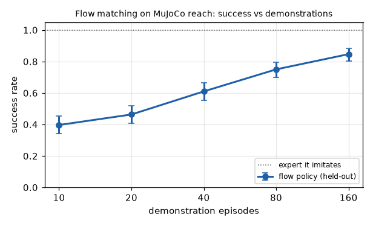
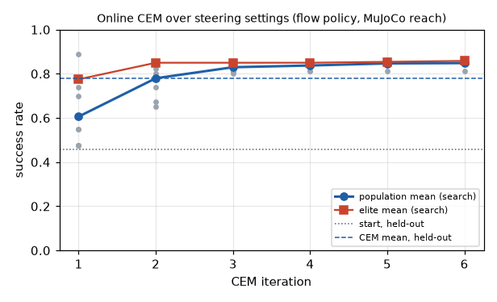

# Learning examples

Runnable examples of the learning layer (`hylo-learn`: learner jobs and sealed artifacts, judge calibration and
labelling, external-data ingestion, online learning) on MuJoCo planar reach. Each script shows one capability and
measures its effect. All run from the harness repository root, write `result.json` and print a results table:

```bash
uv run python examples/learn/01_learner_job.py [--quick] [--out DIR]
```

The default output directory is `runs/examples/learn/<slug>/`. `--quick` finishes in under a minute. The MuJoCo
environment comes from hylo-env-mujoco (hylo-bench) and is referenced only by its registry name,
`mujoco.planar_reach`. Large evaluations run in up to `--workers` processes (default 24). Held-out evaluations use the
standard `heldout` seeds (20000+), which no learner reads.

## Results

Measured on 2026-11-01 on a 128-core CPU without a GPU, full mode (no `--quick`).

| Example | What it shows | Command | Measured result | Runtime |
|---|---|---|---|---|
| [01_learner_job.py](01_learner_job.py) | `TrainJob` + `run_job` for kNN, BC and flow matching: sealed artifacts, tamper and split-guard checks, held-out evaluation, success against the number of demonstrations | `uv run python examples/learn/01_learner_job.py` | On 300 held-out episodes: kNN 0.620, BC 0.783, BC + temporal ensemble 0.837, flow 0.847, flow + 4-sample steering 0.873 (expert 1.000). Flow vs demonstrations: 10 → 0.397, 20 → 0.463, 40 → 0.610, 80 → 0.750, 160 → 0.847. A changed byte and a job asking for `gate` runs were refused; a rerun was skipped | 32 s |
| [02_judge_calibration.py](02_judge_calibration.py) | `judge.trace` learner jobs, `calibrate_judge` against simulator outcomes, `ingest` of a run without outcomes, `label_run` | `uv run python examples/learn/02_judge_calibration.py` | Calibrated on 720 unseen episodes: proprio + target judge AUC 0.993, recall 0.990 at 0.95 precision; proprio-only judge AUC 0.910, recall 0.724. On 400 ingested episodes from another cell, labels were less precise than calibrated: 0.821 (45 false labels) and 0.909. An uncalibrated judge and a simulator run were refused | 86 s |
| [03_online_cem.py](03_online_cem.py) | An online learner (CEM over steering settings) through `run_online`: rollouts on `search`, a sealed artifact listing every rollout run, held-out check | `uv run python examples/learn/03_online_cem.py` | 6 iterations × 8 settings × 80 episodes (48 rollout runs, 3840 episodes). Population mean on `search` 0.606 → 0.848. On 500 held-out episodes: start 0.458, CEM mean 0.778, best setting 0.836 (198:9 vs start, p = 8e-48). The best setting scored 0.887 on `search`. A job rolling out on `gate` was refused | 83 s |



*01: the flow policy's held-out success against the number of demonstrations (95% Wilson intervals). The dotted line
is the IK controller it imitates.*



*03: success of every setting tried (grey), population and elite means on `search`, and the held-out success of the
starting setting and of the final CEM mean.*

## Readings

- **Judges are trustworthy only on the distribution they were calibrated on.** The proprio + target judge reached
  0.95 precision at threshold 0.537 on `search_val`, but labelled the other cell's episodes (other agents, other seeds,
  base rate 0.53) at 0.821 precision. `label_run` enforces the calibrated threshold, but it cannot tell that the data
  has shifted. The threshold is also the lowest one reaching the target on the calibration set, which is optimistic.
  The proprio-only judge has the higher threshold (0.732) and kept 0.909.
- The recorded LIBERO-10 judges give the same picture with images
  (`docs/research/experiments/2026-10-31-success-judges-libero10.md`, recorded, not rerun here): `judge.trace`
  AUC 0.93 and recall 0.55 at 0.95 precision, ready to label. The VLM judge reached AUC 0.61 and was not ready.
- **Selecting on few episodes is optimistic.** CEM's best setting scored 0.887 on the 80 `search` episodes it was
  picked on and 0.836 held out. The demonstrations come from init states disjoint from the rollouts, so the gap is
  selection, not memorisation. The online artifact is a `behaviour` artifact: only the gate can activate it.
- Temporal ensembling (ACT-style) and 4-sample steering each add a few points over their base policy, but the 95%
  intervals of neighbouring rows overlap. Compare two policies with a paired test (see `../evolve/03_gate_power.py`).

## Notes

- `02_judge_calibration.py` trains state-only judges (`cameras: []`): planar reach has no camera. A judge sees only
  the last observation of an episode, never its length or termination reason. The "other cell" is the IK controller
  with gain 0.02 and a noisy flow policy on the standard `train` seeds. They are ingested as `external:other-cell`
  with outcomes withheld, and the withheld outcomes score the labels afterwards.
- `03_online_cem.py` writes its learner in the script and passes it to `run_online`. A plugin learner would be
  referenced by name in a job file and run with `hylo learn`.
