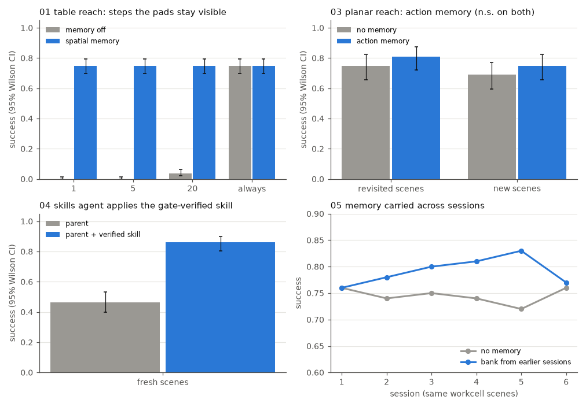

# Memory examples

Runnable examples for the memory layer (`hylo-memory`) and the agents that use it (`hylo-agents`: the
composable agent with spatial memory, `MemorySteeredAgent`, the `skills` agent). Each script shows one capability
and measures its effect against the same agent without it, on the same episodes (paired by task and seed).

```bash
uv run python examples/memory/01_spatial_memory_occlusion.py [--quick] [--out DIR] [--workers N]
uv run python examples/memory/make_figures.py          # assets/memory_results.png from the full runs
uv run pytest tests/test_examples_memory.py            # every example with --quick
```

Run from the harness repository root. Results go to `runs/examples/memory/<slug>/` (a `result.json`, the runs with
their traces, banks and libraries). Seeds are fixed, so a re-run gives the same numbers. The examples need
hylo-bench's MuJoCo adapter (`mujoco.table_reach`, `mujoco.planar_reach`), referenced by registry name only.
`_common.py` holds the shared helpers, including `PriorFlowSampler`, which adds the RFC-0003 prior protocol to the
reference flow policy so `MemorySteeredAgent` can drive it. No LLM is used.

## Results

Full runs on 2026-11-01: 128-core CPU, no GPU, 16 worker threads. p-values are exact two-sided McNemar tests on
the discordant pairs (`+wins / -losses`).

| Example | What it shows | Command | Measured result | Runtime |
|---|---|---|---|---|
| 01 spatial memory under occlusion | `composable.object_reach` on `mujoco.table_reach`, pads visible for 5 steps; `sqlite` spatial memory off vs on; visibility sweep | `uv run python examples/memory/01_spatial_memory_occlusion.py` | 300 pairs: 0.00 [0.00, 0.01] → **0.75** [0.70, 0.80], +225 / -0, p = 4e-68. Per task: direct 0.00 → 0.99, push 0.00 → 0.99, indirect 0.00 → 0.27 (the rule chooser cannot resolve "the colour of a ripe tomato"; memory does not fix language). Pads always visible: 0.75 vs 0.75, memory adds nothing | 86 s |
| 02 observable retrieval | one episode: the `memory.write` / `memory.retrieval` / `agent.decision` timeline from the trace, then the SQLite file queried directly (by key and by radius, with scores) | `uv run python examples/memory/02_observable_retrieval.py` | 1 write (3 ADD), 6 retrievals; decisions switch from `seen` to `remembered` at step 5; recalled pad positions match privileged state exactly (error 0.000 m); success in 21 steps vs failure after 150 steps without memory ("no objects perceived or remembered") | < 1 s |
| 03 action memory: revisited vs new scenes | ActionBank of verified chunks from 3 earlier visits to each search_val scene; `MemorySteeredAgent` (Retrieve-then-Steer) on a noisy flow policy | `uv run python examples/memory/03_action_memory_scene_recall.py` | revisited: 0.75 → 0.81 (+14 / -8, p = 0.29); new (held-out): 0.69 → 0.75 (+12 / -6, p = 0.24). Memory produced a prior at 67% of decisions on revisited scenes vs 41% on new ones, but the outcome effect is the same: **the LIBERO shape (+8 revisited / -8 new) was not reproduced**, both effects are not significant | 48 s |
| 04 skill library | campaign (RFC-0002 gate) → archive → skills with evidence-based status → frozen library → `skills` agent around the unchanged parent | `uv run python examples/memory/04_skill_library.py` | 4 skills: 1 verified (noise scale 3.0 → 0.99; gate +0.42, p = 3e-12), 3 proposed (not gated or not significant). Campaign held-out report 0.56 → 0.84. On fresh scenes (standard validation seeds, disjoint from all campaign splits, 200 pairs): 0.47 [0.40, 0.53] → **0.86** [0.81, 0.90], +85 / -6, p = 6e-19; `skill.applied` in 200 of 200 episodes | 51 s |
| 05 memory across sessions | one process per session on a fixed workcell (the same 100 scenes); each session loads the bank the previous one saved (frozen, digest), then appends its verified successes; a SQLite journal carries session summaries | `uv run python examples/memory/05_memory_across_sessions.py` | session 1 (empty bank) equals the control by construction; sessions 2-6: +4, +5, +7, +11 (p = 0.035), +1 points; pooled +0.056, +63 / -35 (p = 0.006, naive: the scenes repeat across sessions). A small, mostly non-significant per-session gain that grows with the bank until session 6 | 64 s |



Notes on the numbers:

- 03 and 05 use the same memory steering settings (k 5, similarity floor 0.99, fixed t0 0.3), picked from a sweep
  of four settings on example 03's splits; treat their p-values as exploratory. With looser retrieval (k 10, floor
  0.95) and the well-tuned policy (noise 1.0, 0.88 success), memory hurt on both revisited (-0.11, p = 0.03) and
  new scenes (-0.12, p = 0.002) in a development run.
- Why 03 differs from LIBERO: here the retrieval key is the policy's own 8-dimensional state (joint angles,
  fingertip, target position), so a neighbour from another scene is still informative and the prior acts like a
  kNN denoiser everywhere. LIBERO's keys are pooled image features that carry no outcome information on an unseen
  layout.
- 04 needs a proposer that suggests a noise change: the built-in `rule.steering` candidates (voting over 4 samples,
  longer execution) were not promoted on this task, so the script registers a small noise-scale proposer, standing
  in for the LLM proposer of the recorded maturity campaign.

## Recorded LIBERO-10 results

Recorded, not re-run here (frozen SmolVLA, 100 paired search_val episodes, from
`docs/research/experiments/2026-10-30-experience-memory-libero10.md` in hylo-docs):

| Bank | Success | vs control 0.54 |
|---|---|---|
| unseen init states (102 search successes) | 0.46 | -0.08 (+6 / -14, p = 0.115) |
| same scenes, confidence t0 | 0.55 | +0.01 (+8 / -7, p = 1.0) |
| same scenes, fixed t0 0.2 | 0.62 | +0.08 (+13 / -5, p = 0.096) |

The skill library built from the two LIBERO-10 campaigns holds 8 skills, none verified (the two execution_steps 25
candidates were +8 / +9 points on the gate split, p 0.07 / 0.09: recorded as proposed).

## Not covered

- The lesson book (`lesson_book`): lessons change behaviour only through an LLM proposer or planner that reads
  them, so a measured effect needs an LLM in the loop; recorded runs used `llm.reflector` with a local Ollama model.
- `hylo skills ARCHIVE --out LIB` only recognises the steering path of a remote agent
  (`agent.params.params.steering`); example 04's local campaign patches `agent.params.steering`, so the script
  calls the same functions (`skill_from_entry`, `classify`) with that path.
- `MemorySteeredAgent` aggregates the last action dimension as a gripper (`gripper_dim`, no "none" option); the
  planar arm has no gripper, so stored segments carry a constant gripper channel that the sampler drops again.
