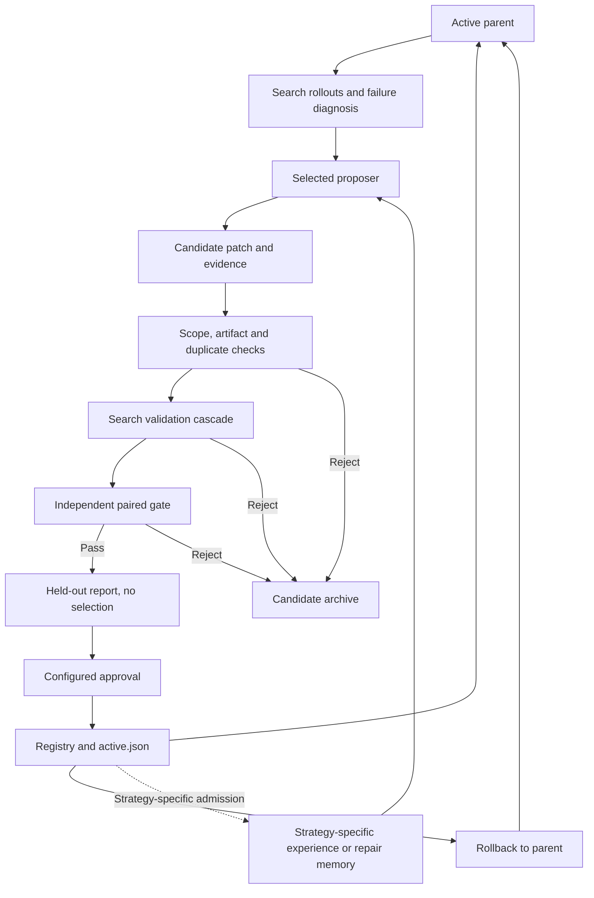

# Self-Evolution

`hylo-evolve` runs Hylo's improvement campaigns: diagnose failures, propose changes,
evaluate them against the active parent, and promote or reject a version. It owns the
validation and version lifecycle; interchangeable proposers decide what to change.

For a frozen-VLA harness, evolution changes the surrounding program, steering parameters,
prompts or reusable experience. It does not require VLA weight updates. Training-based
proposers also exist as explicit options; choosing a program or steering proposer does
not enable them. Episode memory and cross-episode evolution are separate concerns:
a memory-enabled agent can run without an evolution campaign.

## Architecture



The campaign is an outer loop. Runtime agents still execute through their configured
environment, robot tools and kernel. A proposer returns a candidate; it does not activate
it directly. The deployment process consumes the published version through its own
integration; writing `active.json` does not by itself hot-swap every running agent.

## Strategies

| Selection | Evolution unit | Training | Implementation |
| --- | --- | --- | --- |
| `rule.gain` | Configured gain or numeric parameter variants | None | [loop.py](src/hylo/evolve/loop.py) |
| `rule.steering` | Failure-driven steering configuration | None | [steering.py](src/hylo/evolve/steering.py) |
| `llm.steering` | Model-proposed steering patches | None | Optional [hylo-proposer-llm](../../adapters/hylo-proposer-llm/pyproject.toml) |
| `experience` | Lessons and skill evidence supplied to an inner proposer | Depends on the inner proposer | [experience.py](src/hylo/evolve/experience.py) |
| `research.llm` | Executable `solve(robot)` program | None | [Research proposer](../../adapters/hylo-code-agents/src/hylo/codeagents/generator.py) |
| `harness.program` | Phase-guided program repair and evidence-linked repair notes | None | [Harness Program Evolution](../../adapters/hylo-code-agents/examples/harness_evolution/README.md) |
| `critic.chunk_value` | Learned action-chunk ranking around a frozen policy | Critic training | [critic.py](src/hylo/evolve/critic.py) |
| `learn` | Sealed learner output and a patch referencing it | Depends on the learner | [learning.py](src/hylo/evolve/learning.py) |
| `selftrain.expert_iteration` | Policy checkpoint learned from successful rollouts | Policy training | [selftrain.py](src/hylo/evolve/selftrain.py) |

These are alternatives with different runtime requirements, not a single combined
algorithm. Registered names require the corresponding package's entry-point metadata.
A `module:Class` reference can select an implementation directly in an existing environment.

The experimental Working Memory runtime and its dedicated `MemoryPromptCampaign` API
were removed on 2026-11-04. They are not available strategy options. The shared campaign,
program-evolution strategies and their validation/rollback lifecycle remain available.

## Validation

The standard campaign uses four benchmark splits:

| Split | Purpose |
| --- | --- |
| `search` | Parent diagnosis and development feedback |
| `search_val` | Early rejection, candidate comparison and selection |
| `gate` | Confirmatory comparison against the parent on paired episodes |
| `heldout` | Reporting after the gate; not candidate selection |

[ProtocolConfig](src/hylo/evolve/protocol.py) controls the cascade, candidate limit,
paired-test plugin, regression limits and optional sequential looks. The default test is
McNemar on success. Multiple selected candidates use Holm correction; multiple configured
looks use alpha spending and require corresponding benchmark gate splits. Episode counts
and seeds come from the benchmark, not from the proposer.

Stage zero checks protected configuration scope and referenced artifacts. Currently,
`config_patch` and `code` candidates are enabled. Code candidates may change only the
agent, must reference a sealed program and cannot carry inline source. Contract enum
values for other candidate kinds do not mean those kinds are enabled.

The proposer interface receives the campaign archive as well as the search diagnosis.
Custom proposers must control which archive fields reach a model; the shared interface
is not an information-isolation boundary. `harness.program` ignores raw archive input,
checks the diagnosis split and uses its own admitted-note retrieval. Observation access
also depends on the chosen toolkit: the protocol alone does not prevent simulator-state
leakage through tools.

## Program Evolution

`harness.program` independently adapts HarnessPAI's design:

1. Retrieve relevant repair notes and ask a model for observable task phases.
2. Develop and repair `solve(robot)` using the configured toolkit on search cases.
3. Automatically evaluate completed program revisions within the submission budget.
   Explicit submissions are not duplicated; unchanged collected source is skipped.
4. Require all selected development cases to succeed before returning a candidate.
5. Distill notes citing a real failure and a successful replay of the same development
   case in the selected program. Invalid notes are discarded.
6. Seal the program, phase plan, notes and evidence; pass the candidate to the campaign.

Repair recall uses lexical overlap and phase-name matching over active promoted lineages.
Pending candidates and rolled-back branches do not contribute notes. The note artifact
must match the digest recorded in its admitted candidate. Rollback therefore changes both
the active program and which branch's repair notes can be recalled. This rule belongs to
`PhaseRepairMemory`; other memory backends have their own admission and retention rules.

A phase plan guides generated code; it is not a centrally enforced phase interpreter.
A note is evidence about a repaired program, not a proven transferable skill. A frozen
VLA is callable only if the configured toolkit exposes it; this strategy does not
automatically turn SimpleMemVLA into a callable robot tool.

The audited HarnessPAI snapshot has no project license. This implementation references
its design without copying upstream source, prompts or templates. See the
[strategy README](../../adapters/hylo-code-agents/examples/harness_evolution/README.md)
for the pinned source references, limitations and configuration.

## Usage

Run from the `hyloai` workspace root with the relevant Hylo packages already available.
The bundled program-evolution example uses a CPU toy environment and an existing local
Ollama `gpt-oss:20b` service. It does not download models or install dependencies:

```bash
.venv/bin/python -m hylo.core.cli evolve run \
  harness/adapters/hylo-code-agents/examples/harness_evolution/campaign.yaml
.venv/bin/python -m hylo.core.cli evolve status runs/harness-program-toy
```

The [example config](../../adapters/hylo-code-agents/examples/harness_evolution/campaign.yaml)
selects the proposer by module reference. It explicitly uses `approval: auto` for this toy
probe. The current `EvolveConfig` default is also `auto`; set `approval: manual` when the
campaign should wait for review. A passing candidate then remains pending until:

```bash
.venv/bin/python -m hylo.core.cli evolve approve runs/harness-program-toy
```

To restore an active version's parent:

```bash
.venv/bin/python -m hylo.core.cli evolve rollback runs/harness-program-toy \
  --reason "Regression observed after promotion"
```

Repeating `evolve run` resumes persisted campaign state rather than starting a fresh
experiment. Use a new output directory for an independent run. Campaign and cycle
wall-clock budgets are checked at orchestration boundaries; they are not a universal
hard timeout for an in-flight model call or rollout. Proposers and runtimes have their
own call, token, submission and execution limits.

## Artifacts

| Campaign path | Contents |
| --- | --- |
| `evolve_config.json` | Resolved campaign configuration |
| `campaign_state.json` | Completed cycles, progress and stop reason |
| `cycle-*/cycle_report.json` | Diagnosis, candidate stages, verdicts and held-out report |
| `archive.jsonl` | Candidate hypotheses, evaluation outcomes and evidence |
| `registry/versions/` | Registered candidates and parent relationships |
| `registry/ACTIVE`, `registry/ledger.jsonl` | Active pointer and version operations |
| `pending_approval.json` | Gate-passing candidate awaiting configured manual approval |
| `active.json` | Published effective agent configuration and lineage |

Program development traces, plans, sealed programs and note evidence live under the
proposer's configured `out_root`. Rejected candidates remain available for audit; rollback
changes the active pointer rather than erasing history.

## Extension

Implement the [Proposer contract](../hylo-core/src/hylo/core/improvement.py):

```python
def propose(self, diagnosis, cfg, parent_id, archive):
    # Return [(Candidate(...), hypothesis), ...]. Return [] when evidence is insufficient.
    ...
```

Register it in the `hylo.generators` entry-point group or select it by module reference.
Return a bounded configuration patch or sealed code artifact with rationale and provenance.
Keep benchmark definitions, evaluation settings and protected runtime settings outside the
patch. Reuse the campaign for selection, confirmation and activation; define explicitly
how any additional memory follows promotion and rollback. There is no automatic guarantee
that an arbitrary inner proposer consumes the lessons attached by `experience`.

## Verification

[Implemented] Campaign, gate, registry and proposer implementations are linked above.
The [evolution examples](../../examples/evolve/README.md) document earlier measured
campaigns, gate-power checks and rollback demonstrations; those results are specific to
their tasks and setups.

On 2026-11-04, the new program-evolution work passed 34 distinct strategy and regression
test cases across its final checks, plus three package-boundary checks. The scripted-model
integration exercises failure, repair, gate, approval, recall and rollback with the real
Hylo kernel. It verifies mechanics, not autonomous discovery.

[Unverified] Five real-model toy probes produced no promoted candidate. The latest
submitted four program revisions, each solving 0/2 development cases. These are adaptive
development attempts, not eight independent benchmark samples. No robot benchmark gain
or cross-task repair-transfer benefit has been established for `harness.program`.

[Needs model/hardware] Real program synthesis needs a reasoning model; VLA-backed robot
evaluation additionally needs a compatible action-model toolkit and simulation or robot
runtime. The current toy's privileged perception is not a deployment-observation test.

Useful entry points:

- [Campaign orchestration](src/hylo/evolve/campaign.py)
- [Validation protocol](src/hylo/evolve/protocol.py)
- [Registry and protected scope](src/hylo/evolve/candidate.py)
- [Program-evolution tests](../../adapters/hylo-code-agents/tests/test_harness_evolution.py)
- [Improvement interface](../../docs/interfaces/improvement.md)
