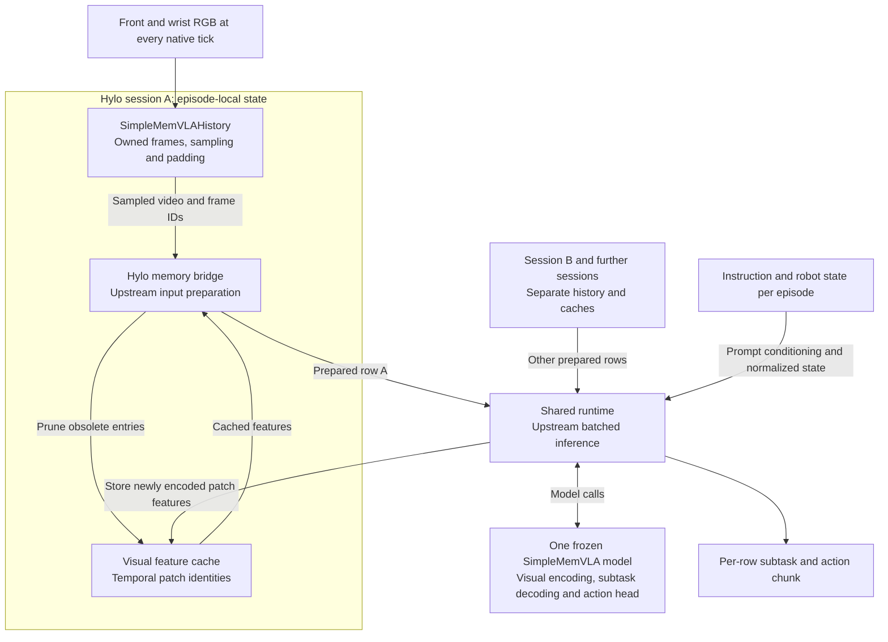
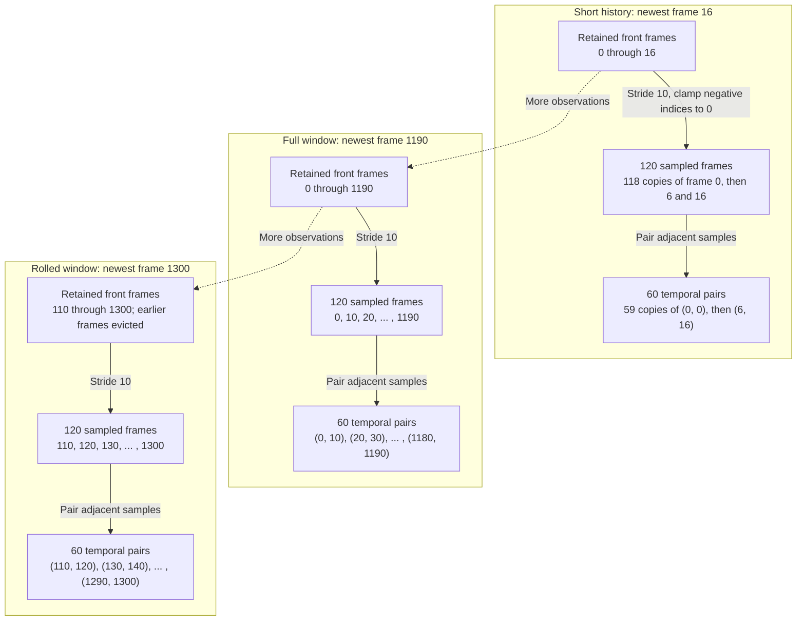

# SimpleMemVLA Implementation

SimpleMemVLA is one optional memory scheme in Hylo. This implementation reproduces its
episode-local video history and connects it to the released frozen SimpleMemVLA model.
Other memory schemes remain independently selectable. No training is performed.

For agent selection, runtime dependencies and controller requirements, see the
[adapter README](../../../../adapters/hylo-policy-simplememvla/README.md).

## Source Map

| File | Responsibility |
| --- | --- |
| [simplememvla.py](../../src/hylo/memory/simplememvla.py) | RGB buffers, frame sampling, padding, temporal patch identities and feature-cache storage |
| [bridge.py](../../../../adapters/hylo-policy-simplememvla/src/hylo/policies/simplememvla/bridge.py) | Bind Hylo memory to the upstream policy and reconnect shared containers after reset |
| [runtime.py](../../../../adapters/hylo-policy-simplememvla/src/hylo/policies/simplememvla/runtime.py) | Load one frozen model, create independent sessions and perform batched inference |
| [agent.py](../../../../adapters/hylo-policy-simplememvla/src/hylo/policies/simplememvla/agent.py) | Hylo agent lifecycle, observation mapping, action chunks and per-decision seeds |

Hylo owns the frame store and sampling implementation. Upstream code supplies image
processing, prompt preparation, visual feature computation and eviction, subtask decoding
and the action head. The model is a separate pinned runtime dependency. The memory backend
can run on CPU by itself; policy inference requires the compatible checkpoint and its
inference environment.

## Data Flow



Each episode owns its history and cache; only model weights are shared. The diagram shows
explicit multi-session runtime batching. The native agent's `act()` submits a single row;
it does not automatically collect requests from other agents. Instruction text participates
in upstream input preparation, while robot state is normalized before batched inference.

1. `observe()` validates all required camera images, then stores owned, read-only RGB
   copies. Each call represents one native camera tick, including demonstration frames.
2. `positions()` selects frame positions within each retained buffer. `frame_ids()`
   converts them to episode-global indices, preserving identity when the window rolls.
3. `video()` stacks the selected images. `patch_keys()` pairs consecutive sampled history
   frames into `(camera, first_frame_id, second_frame_id)` cache keys.
4. The bridge supplies these videos and keys to upstream preprocessing. Visual features
   are cached per session and pruned by upstream code as patches leave the current window.
5. The frozen model consumes the prepared visual history, instruction and normalized
   robot state, producing a subtask and an action chunk.

This is a streaming visual-memory API. Retrieval consists of selecting the upstream
temporal window; it does not use semantic nearest-neighbor search or the `MemoryStore`
query/write protocol.

## Window Semantics

| Setting | Released RoboMME configuration |
| --- | --- |
| History camera | Front |
| Current-only camera | Wrist |
| History duration and sampling rate | 60 seconds, 2 fps |
| Native rate | 20 fps |
| Sample count and stride | 120 frames, every 10 native frames |
| Maximum retained raw frames | 1,191 front frames and one wrist frame |
| Temporal patch size | Two sampled frames |

The sample count is `max(2, round(duration * history_fps))`, rounded up to an even number.
The stride is `max(1, round(native_fps / history_fps))`. A history buffer retains
`(sample_count - 1) * stride + 1` frames. Python's `round` behavior matches upstream.
Sampling uses frame indices rather than wall-clock timestamps.

Fixed windows repeat the first available frame when history is short. When a checkpoint
enables `variable_history`, the sample count grows with available history and is rounded
up to an even number. The bridge reads these settings from the checkpoint configuration.



These examples use the default fixed window and zero-based episode-global frame IDs.
Sampling is anchored to the newest frame, so frame 16 selects 6 and 16 rather than 0 and
10 as its last two samples. A cache key also includes the camera name. Repeated padded
pairs share a key; 60 pair positions do not necessarily mean 60 distinct cache entries.
The wrist camera supplies only its latest frame and is omitted from this history diagram.

## Memory API

```python
import numpy as np
from hylo.memory.simplememvla import SimpleMemVLAHistory

memory = SimpleMemVLAHistory()
memory.reset("episode-1")
memory.observe({
    "front": np.zeros((256, 256, 3), dtype=np.uint8),
    "wrist": np.zeros((256, 256, 3), dtype=np.uint8),
})
front_video = memory.video("front")  # (120, 256, 256, 3), initially padded
patch_ids = memory.patch_keys()     # 60 temporal pairs
diagnostics = memory.snapshot()     # Counts and sampled IDs, not image payloads
memory.reset("episode-2")           # Clears frames, counters and feature cache
```

Inputs must be nonempty uint8 HWC RGB arrays with stable per-camera shapes within an
episode. A malformed camera tick is rejected before any camera is appended. `current()`
returns a copy; `video()` returns a stacked array. `reset()` preserves the identities of
the buffer, counter and feature-cache containers used by the inference bridge.

## Agent Lifecycle and Batching

`reset(ctx)` creates an episode session and checks the released eight-dimensional Panda
joint-position interface and control rate. An optional `observe_history(prefix)` call
supplies demonstration frames before the first `act()`; the prefix excludes the current
observation. `on_step()` records every executed control step, including steps within an
action chunk. `act()` avoids appending that same step again. `on_episode_end()` clears the
session. Only selected RGB images, arm/gripper state and instruction reach the model.

`SimpleMemVLARuntime.new_session()` creates separate history and caches while sharing model
weights. `infer_batch(sessions, instructions, states)` preserves row order and requires
distinct sessions belonging to that runtime. A caller assembles batches explicitly; the
native agent's `act()` currently submits one session. An explicit seed scopes inference
RNG state, while `seed=None` follows upstream shared-stream batching. Changing batch
composition can change action noise and trajectories.

## Verification

Recorded on 2026-11-04:

- 58 affected CPU tests and four targeted package-boundary checks passed.
- 18 fixed/variable-history sampling comparisons matched upstream.
- Five GPU comparisons with batch 2 matched prepared inputs and subtask text, with
  bitwise-identical action chunks, covering padding, rollover and instruction changes.
- The Hylo memory bridge completed 8/8 RoboMME regression episodes: PickXtimes,
  VideoUnmask, PickHighlight and PatternLock, each with previously observed test IDs 0 and 1.

The GPU closed-loop test used the native RoboMME evaluator with Hylo memory sessions.
The full native Hylo kernel path remains unverified; its agent lifecycle has CPU coverage.
The eight episodes are implementation regression, not fresh held-out performance or
evidence of a gain over another memory scheme. See the workspace experiment record at
`docs/docs/research/experiments/2026-11-04-simplememvla-integration.md`.

From the workspace root, in an existing development environment, run the focused CPU tests:

```bash
PYTHONPATH="$PWD/harness/adapters/hylo-policy-simplememvla/src:$PWD/harness/packages/hylo-memory/src:$PWD/harness/packages/hylo-core/src${PYTHONPATH:+:$PYTHONPATH}" \
  .venv/bin/python -m pytest \
  harness/packages/hylo-memory/tests/test_simplememvla.py \
  harness/adapters/hylo-policy-simplememvla/tests -q
```

The opt-in [upstream comparison script](../../../../adapters/hylo-policy-simplememvla/tests/verify_upstream.py)
requires the pinned upstream source, prepared GPU environment and local checkpoint.
It is separate from default CPU tests and does not install dependencies or download weights.

## Provenance

Source: `OpenBMB/SimpleMemVLA@453d6ec293e63318bbc2bce545d0b9256ab1bc51`.
Checkpoint: `yinchenghust/simplememvla_robomme@6bf7204311496b93f12889cad0eaf3fcbddc35e4`.
The reproduced sampling rules retain the upstream MIT attribution in
[THIRD_PARTY_NOTICES.md](../../THIRD_PARTY_NOTICES.md). Original reference checkouts remain
unchanged. The adapter README records the tested inference dependencies and model interface.
